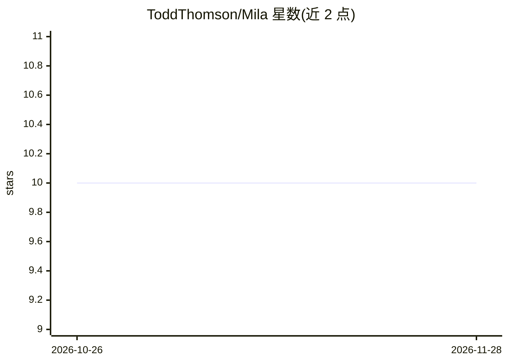

# ToddThomson/Mila

⭐ 10 · C++ · MIT · 推送 2026-11-27 · [GitHub](https://github.com/ToddThomson/Mila) · [官网](https://mila.toddt.me) · 个人维护

**面向研究者的 C++23 本地 LLM 推理与训练库**

以显式神经网络组件构建的 C++23 库，无 autograd 引擎与运行时分发，前向/反向传播逐组件手写，设备与精度在编译期以模板参数确定。支持 BF16/FP8/FP4 量化与 cuBLASLt 矩阵运算，附带 Chat CLI 与导出 OpenAI/Anthropic 兼容接口的推理服务器（MIS）。已验证 Llama 3.x、Gemma 4、Qwen 3.8 推理与 GPT-2 训练，权重与 HuggingFace 逐 token 对齐。目标是让 12–16 GB 消费级显卡运行当前开源模型。

## 筛选速览

| 维度 | 判定 | 备注 |
|---|---|---|
| AI 角色 | `ai-ecosystem` | LLM/agent 周边工具 |
| 许可风险 | `permissive` | MIT |
| 部署形态 | `self-host` | docker 或自建部署 |
| 模型依赖 | — | README 未给出锁定关系 |
| 硬件要求 | — | 无带数字的原话,不猜 |
| 安装摩擦 | `low` | 无编译、无系统依赖或容器化 |
| 成熟度 | `idea` | |

## 能力要点

- 编译期确定设备与精度，前向/反向显式可审计
- BF16/FP8/FP4 编译期量化策略，12 GB 消费级显卡可运行
- MIS 推理服务器提供 OpenAI/Anthropic 兼容接口
- Llama/Gemma/Qwen/GPT-2 逐 token 对照 HuggingFace 验证

## 适用场景

- 研究新架构时需要完全可见的计算与梯度流
- 在消费级显卡上本地运行开源 LLM 并接入 Codex/Claude Code 等
- 通过阅读完整代码学习模型各组件的实现

## 场景标签

`推理引擎` `模型量化` `模型训练` · 领域:训练与推理

## 证据(README 行号)

> L26: That philosophy fixes Mila's product shape: an **inference runtime library plus a small family of
> L63: **CUDA-native.** Matrix operations via cuBLASLt. Hand-written kernels where control
> L176: |Mila Inference Server (MIS) — OpenAI/Anthropic wire|Validated — Codex and Claude Code CLI round-trips on Gemma 4 

## 星数曲线

2026-10-26 10 → 2026-11-28 10（+0）

---
*卡片 v1 · prompt 1.4 · 生成 2026-11-20 · 置信度 mid · 依据 README sha `c6cc4c52e551` · [字段定义](../../DATASET.md)*
