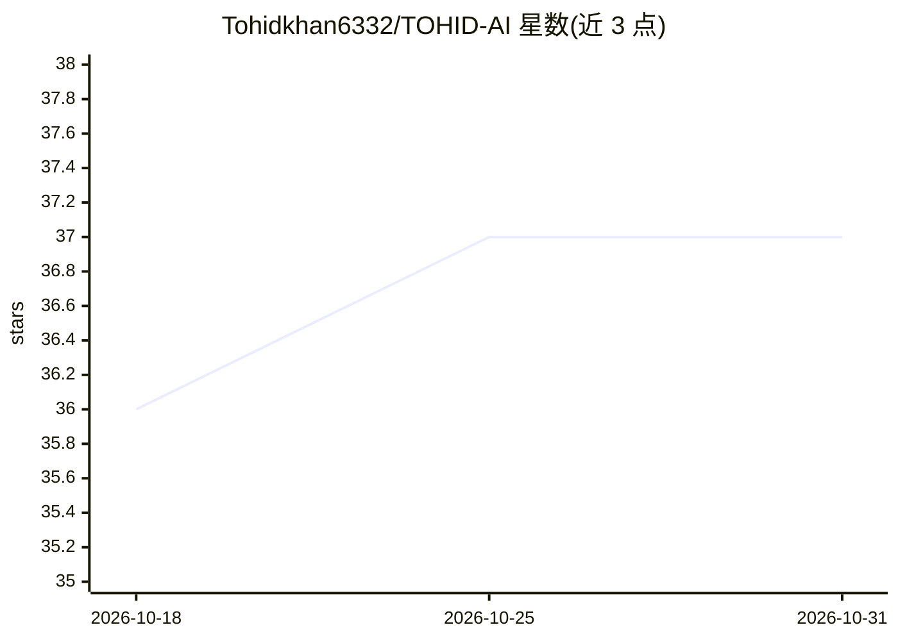

# Tohidkhan6332/TOHID-AI

⭐ 37 · JavaScript · MIT · 推送 2026-09-18 · [GitHub](https://github.com/Tohidkhan6332/TOHID-AI) · [官网](https://whatsapp.com/channel/0029VaGyP933bbVC7G0x0i2T) · 个人维护

**多功能 WhatsApp 自动化机器人，含 AI 图像生成与媒体下载**

基于 Baileys API 的多设备 WhatsApp 机器人，面向个人用户在群聊中使用：提供自动表情回应、贴纸、从各平台链接下载媒体、音频编辑、互动投票、游戏，以及根据提示词文本生成图像的 Imagen AI 功能。通过 SESSION_ID 或 QR 码配对连接账号，可配置自动已读、状态查看、反删除转发等开关；提供 Heroku、Koyeb、Railway、Render、Replit 等托管平台部署入口，也可在 Ubuntu/Fedora（含 Termux proot 环境）下源码运行，需安装 ffmpeg、ImageMagick、libwebp 等系统依赖。

## 筛选速览

| 维度 | 判定 | 备注 |
|---|---|---|
| AI 角色 | `ai-enhanced` | 去掉 AI 部分产品仍成立 |
| 许可风险 | `permissive` | MIT |
| 部署形态 | `library` | 以包/库形式分发 |
| 模型依赖 | — | README 未给出锁定关系 |
| 硬件要求 | — | 无带数字的原话,不猜 |
| 安装摩擦 | `high` | 编译与系统依赖俱全 |
| 成熟度 | — | 结构信号不足 |

## 能力要点

- 基于提示词/文本生成图像的 Imagen AI（多 AI 模型）
- 从多平台链接下载图片、文件、视频
- 自动表情回应、状态查看、已读等可配置自动化行为
- 提供多个托管平台一键部署与 Termux 本地运行指南

## 适用场景

- 在 WhatsApp 群里让机器人自动回应、发贴纸和投票
- 通过链接下载音视频与图片等媒体
- 用文字提示词直接生成图片发送到聊天

## 场景标签

`聊天机器人` `图像生成` `网页抓取` · 领域:效率与自动化

## 证据(README 行号)

> L43: - **Imagen Ai** Many Image Generator**AI Models** Will Generates Images And Designs Based On Your **Prompts/text**.
> L158: **TOHID-AI** is a multi-functional WhatsApp bot designed for automatic reactions, status updates, motivational quo

## 星数曲线

2026-10-18 36 → 2026-10-31 37（+1）

---
*卡片 v1 · prompt 1.4 · 生成 2026-10-25 · 置信度 mid · 依据 README sha `9e1699b2e14d` · [字段定义](../../DATASET.md)*
