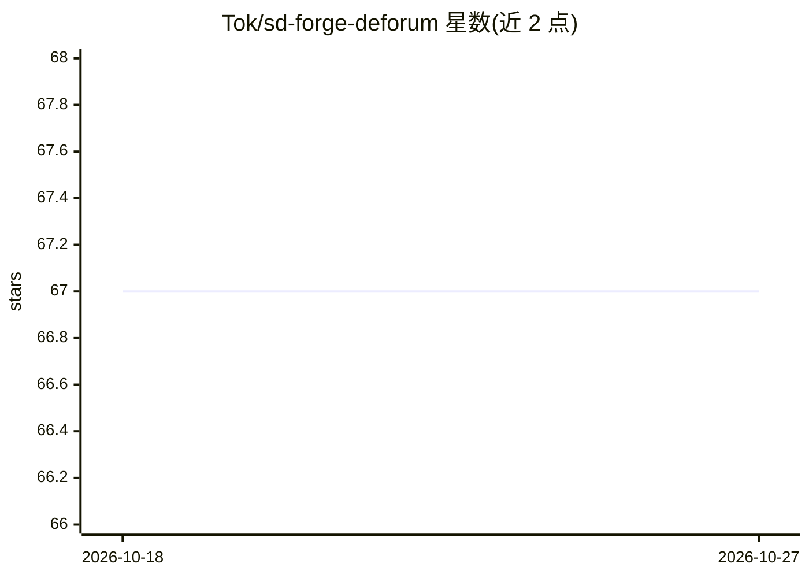

# Tok/sd-forge-deforum

⭐ 67 · Python · NOASSERTION · 推送 2026-06-14 · [GitHub](https://github.com/Tok/sd-forge-deforum) · [官网](https://tok.github.io/sd-forge-deforum/) · 个人维护

**Deforum 动画扩展的 Flux 适配 fork，支持 Wan 2.1 视频生成**

Deforum 扩展（面向 Stable Diffusion WebUI Forge）的实验性分支：适配 Flux.1 模型、集成 Parseq 关键帧重分配逻辑，并支持 Wan 2.1 文生/图生视频，与 Deforum 的提示词调度、FPS、种子与强度调度系统联动。附带 Qwen 提示词扩写与运镜翻译（按 VRAM 自动选 3B/7B/14B 模型、懒加载与自动清理）、I2V 链式续接、Camera Shakify 抖动数据集成；dev 分支需 Forge Neo。安装经 Forge 扩展页或 git clone 后 pip install requirements。

## 筛选速览

| 维度 | 判定 | 备注 |
|---|---|---|
| AI 角色 | `ai-native` | 本体是模型或模型工具 |
| 许可风险 | `none` | NOASSERTION |
| 部署形态 | `library` | 以包/库形式分发 |
| 模型依赖 | — | README 未给出锁定关系 |
| 硬件要求 | — | 无带数字的原话,不猜 |
| 安装摩擦 | `medium` | 含编译或系统依赖之一 |
| 成熟度 | `idea` | |

## 能力要点

- 适配 Flux.1 并支持 Wan 2.1 文生/图生视频，接入 Deforum 调度系统
- Qwen 提示词扩写与运镜描述翻译，按 VRAM 自动选择模型
- I2V 链式续接与 VACE 一体化模型工作流
- dev 分支提供 Depth Anything V3 + 3D Gaussian Splatting 插值

## 适用场景

- 在 Forge 中用 Flux 生成逐帧调度动画
- 用 Wan 2.1 按 Deforum 时间表生成带镜头运动的视频
- 用 Qwen 自动扩写提示词并翻译运镜参数

## 场景标签

`图像生成` `视频生成` · 领域:内容生成

## 证据(README 行号)

> L4: for Stable Diffusion WebUI Forge,
> L5: fix'd up to work with Flux.1, integrate Parseq keyframe redistribution logic, and support **Wan 2.1 AI Video Generat
> L102: The extension includes **Wan 2.1** (Alibaba's state-of-the-art video generation model) fully integrated with Defor

## 星数曲线

2026-10-18 67 → 2026-10-27 67（+0）

---
*卡片 v1 · prompt 1.4 · 生成 2026-10-24 · 置信度 mid · 依据 README sha `5f200cfa26a7` · [字段定义](../../DATASET.md)*
