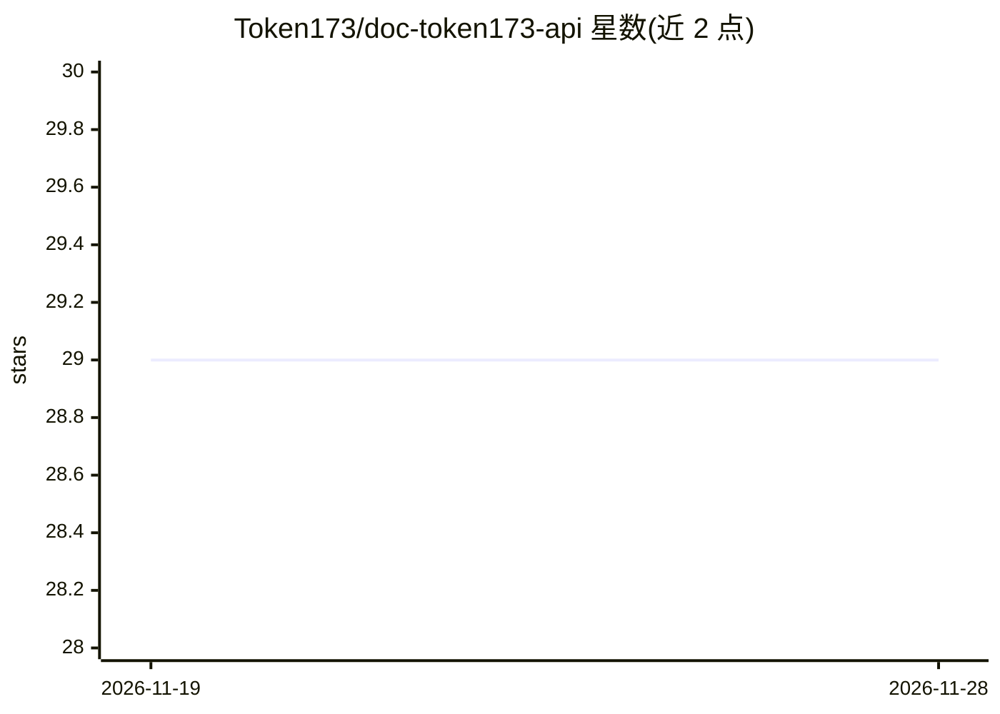

# Token173/doc-token173-api

⭐ 29 · 推送 2026-11-18 · [GitHub](https://github.com/Token173/doc-token173-api) · [官网](https://token173.net) · 组织维护 · 中文 README

**面向 API 使用者的中转站接入教程与模型 ID 文档**

docs.token173.net 的 GitHub 镜像文档仓库，内容为 Token173.net 中转 API 平台的接入说明：提供 OpenAI 兼容、Anthropic、Google 原生三种协议的 Base URL 对照表，列出文本/图像/视频各系列模型 ID，附 curl 快速验证示例、常见客户端（Cherry Studio、LobeChat、Claude Code 等）配置项、按 token 计费规则与 404/401 等常见问题解答。docs/ 下按接口分文件提供 OpenAPI 描述，可导入 Postman 或 Apifox。使用该平台需在其官网注册账号并充值。

## 筛选速览

| 维度 | 判定 | 备注 |
|---|---|---|
| AI 角色 | `ai-ecosystem` | LLM/agent 周边工具 |
| 许可风险 | `none` | — |
| 部署形态 | `None` |  |
| 模型依赖 | — | README 未给出锁定关系 |
| 硬件要求 | — | 无带数字的原话,不猜 |
| 安装摩擦 | `low` | 无编译、无系统依赖或容器化 |
| 成熟度 | — | 结构信号不足 |

## 能力要点

- 三种协议（OpenAI 兼容/Anthropic/Google 原生）的 Base URL 对照表
- 文本、图像、视频模型 ID 清单与接入说明
- docs/ 下按接口分文件的 OpenAPI 描述，可导入 Postman/Apifox
- 覆盖 404、401、模型名错误等常见问题的解答

## 适用场景

- 配置客户端接入 token173.net 中转 API 时查 Base URL
- 查阅该平台支持的模型 ID 与所属协议
- 将 OpenAPI 描述导入 Postman/Apifox 查看接口参数

## 场景标签

`教程课程` · 领域:学习与行业

## 证据(README 行号)

> L3: docs.token173.net 的 GitHub 镜像。线上文档站：https://docs.token173.net
> L15: |OpenAI 兼容（GPT / Gemini / Grok / 国产模型）|`https://token173.net/v1`|必须带 `/v1`|
> L67: `docs/` 下按接口分文件，每个文件是一份 OpenAPI 描述，可以直接导入 Postman 或 Apifox。想看某个接口的参数和返回结构，找对应的 md 文件即可。

## 星数曲线

2026-11-19 29 → 2026-11-28 29（+0）

---
*卡片 v1 · prompt 1.4 · 生成 2026-11-19 · 置信度 high · 依据 README sha `a3efaee37c11` · [字段定义](../../DATASET.md)*
