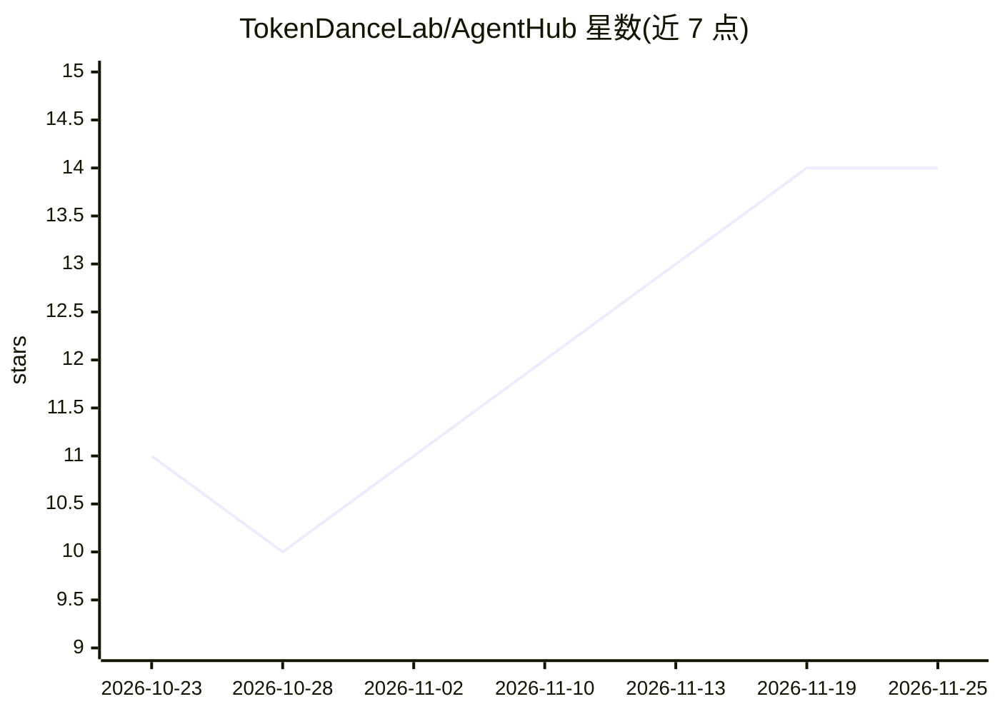

# TokenDanceLab/AgentHub

⭐ 14 · TypeScript · Apache-2.0 · 推送 2026-11-22 · [GitHub](https://github.com/TokenDanceLab/AgentHub) · [官网](https://hub.tokendancelab.com) · 组织维护 · 中文 README

**把 AI Agent 拉进 IM 群聊协作的多智能体平台**

以 IM 群聊为交互形态的多智能体协作平台：用户在单聊/群聊中 @Claude Code、Codex、OpenCode 等 Agent，围绕代码、文档、Diff、Preview、Approval 协同工作。采用 Hub-Edge 架构，本地执行不依赖 Hub，Hub 提供多端同步、远程查看和审计。后端 Go（PostgreSQL/Redis/SQLite），客户端提供 Tauri Desktop、Web 与 Expo React Native Mobile 三端（Mobile 为非 release candidate 的验证 lane）。本地启动需 OpenSSL、Docker、Go 1.27.3、Node 24+/corepack、pnpm 10+。

## 筛选速览

| 维度 | 判定 | 备注 |
|---|---|---|
| AI 角色 | `ai-ecosystem` | LLM/agent 周边工具 |
| 许可风险 | `permissive` | Apache-2.0 |
| 部署形态 | `self-host` | docker 或自建部署 |
| 模型依赖 | — | README 未给出锁定关系 |
| 硬件要求 | — | 无带数字的原话,不猜 |
| 安装摩擦 | `low` | 无编译、无系统依赖或容器化 |
| 成熟度 | — | 结构信号不足 |

## 能力要点

- IM 形态协作：单聊、群聊、@Agent 在同一任务流完成
- Claude Code、Codex、OpenCode 经统一 Adapter 接入
- Diff/Preview/Approval 代码变更审批流
- Hub-Edge 分布式：本地执行不依赖 Hub，Hub 提供同步与审计

## 适用场景

- 在 IM 群聊里像派任务给队友一样派任务给 AI Agent
- 代码变更经 Diff 预览与审批流后再合入
- 团队多端同步查看 Agent 执行过程与产物

## 场景标签

`多智能体` `编码 Agent` · 领域:Agent 开发

## 证据(README 行号)

> L5:  把 AI Agent 当队友一样拉进群聊。和真人好友、AI Builder、AI Reviewer 在同一个 IM 里聊天协作——消息就是任务流，聊天就是工作台。
> L23: - **多 Runtime 调度** — Claude Code、Codex、OpenCode 通过统一 Adapter 接入

## 星数曲线

2026-10-23 11 → 2026-11-25 14（+3）

---
*卡片 v1 · prompt 1.4 · 生成 2026-11-18 · 置信度 high · 依据 README sha `b1f2c931a2aa` · [字段定义](../../DATASET.md)*
