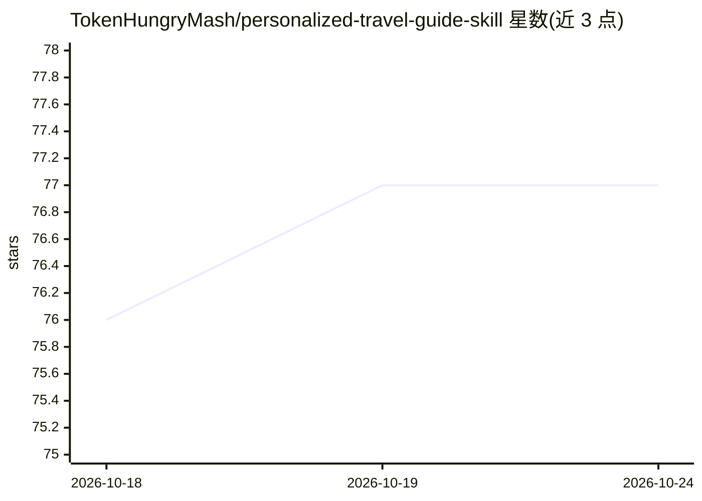

# TokenHungryMash/personalized-travel-guide-skill

⭐ 77 · Python · MIT · 推送 2026-09-16 · [GitHub](https://github.com/TokenHungryMash/personalized-travel-guide-skill) · 个人维护 · 中文 README

**为 AI Agent 生成个性化移动端旅行攻略网页手册的技能**

面向 Codex 等 Agent 的本地技能包：通过问卷收集行程信息，先产出逐日行程草案供确认，再生成可离线打开的单文件 HTML 旅行手册，保留八模块结构，涵盖行程、路线、摄影穿搭提示、备选方案、记账与汇率换算等。支持保存小红书链接、PDF 票据与图片等自定义资料，可选部署到 Cloudflare 云端实现共享、分摊记账与访问码保护。运行需 Python 3.10+ 与 Pillow。

## 筛选速览

| 维度 | 判定 | 备注 |
|---|---|---|
| AI 角色 | `ai-native` | 本体是模型或模型工具 |
| 许可风险 | `permissive` | MIT |
| 部署形态 | `None` |  |
| 模型依赖 | — | README 未给出锁定关系 |
| 硬件要求 | — | 无带数字的原话,不猜 |
| 安装摩擦 | `low` | 无编译、无系统依赖或容器化 |
| 成熟度 | — | 结构信号不足 |

## 能力要点

- 问卷→草案确认→生成完整 HTML 手册的流程
- 离线单文件 HTML 交付，无需解压，可添加到手机桌面
- 可选 Cloudflare 云部署，支持共享、记账分摊与访问码
- 自定义行程资料（小红书链接、PDF 票据、图片）

## 适用场景

- 出行前生成一份手机上可随时查看的完整旅行攻略手册
- 与同行伙伴通过链接共享行程、记账与分摊
- 旅途中集中查看每日行程、路线图与参考资料

## 场景标签

`AI 写作` · 领域:内容生成

## 证据(README 行号)

> L24: - **先确认行程，再生成手册**：生成前先与用户确认旅行安排，支持沟通调整后再制作完整攻略。
> L33: 2. 在 Codex 中说：`使用 $build-personalized-travel-guide-open-source 开始制作旅行手册。`
> L40: 完成后会生成一份可直接打开的离线 HTML 手册，无需解压。导航链接和共享功能需要联网。

## 星数曲线

2026-10-18 76 → 2026-10-24 77（+1）

---
*卡片 v1 · prompt 1.4 · 生成 2026-10-24 · 置信度 mid · 依据 README sha `9dc0d0dfe496` · [字段定义](../../DATASET.md)*
