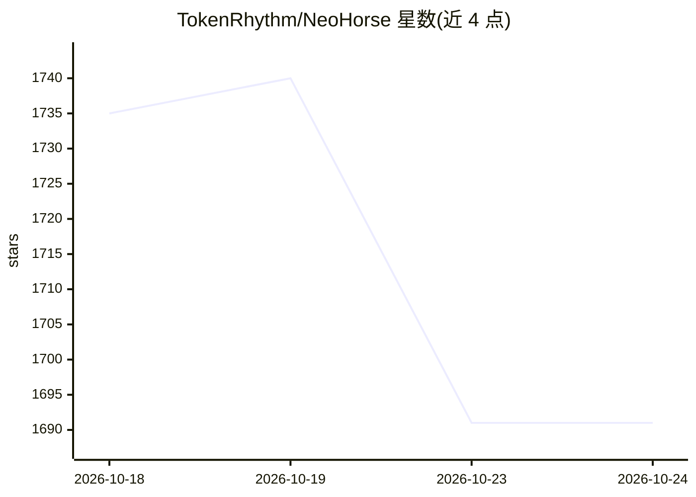

# TokenRhythm/NeoHorse

⭐ 1,691 · Python · Apache-2.0 · 推送 2026-09-26 · [GitHub](https://github.com/TokenRhythm/NeoHorse) · 组织维护 · 中文 README

**开源权重 agent 语言模型系列（4B/9B）及结构化决策模型**

TokenRhythm 发布的开放权重模型家族：NeoHorse-1 提供 4B/9B 因果语言模型，基于 Qwen3.5 经路由引导的 agentic 后训练，面向工具调用、编码与指令跟随，文本输入/输出接口，原生 262,144 上下文。NeoHorse-Jev-4B 基于 NeoHorse-1-4B，通过 prefill-only 推理输出结构化决策（Choice/Noul/Score）。权重以 Apache-2.0 发布于 Hugging Face 与 ModelScope，含 GGUF 量化版与 Apple silicon MLX 版，可用 SGLang/vLLM 部署。

## 筛选速览

| 维度 | 判定 | 备注 |
|---|---|---|
| AI 角色 | `ai-native` | 本体是模型或模型工具 |
| 许可风险 | `permissive` | Apache-2.0 |
| 部署形态 | `library` | 以包/库形式分发 |
| 模型依赖 | local-ok | 支持本地模型 |
| 硬件要求 | — | 无带数字的原话,不猜 |
| 安装摩擦 | `low` | 无编译、无系统依赖或容器化 |
| 成熟度 | `idea` | |

## 能力要点

- 4B/9B 两档开放权重模型（Safetensors/BF16，Apache-2.0）
- 路由引导的后训练框架：课程 SFT 与 on-policy 蒸馏
- NeoHorse-Jev-4B 用 prefill-only 推理输出结构化决策
- 发布 GGUF（4/5/8-bit）量化版与 Apple silicon MLX 版

## 适用场景

- 本地部署一个面向工具调用与编码的 agent 语言模型
- 在应用中用决策模型做请求路由、工具选择或流程控制
- 通过 vLLM/SGLang 以 OpenAI 兼容接口调用

## 场景标签

 · 领域:大模型/agent

## 证据(README 行号)

> L66: NeoHorse-1 is a family of causal language models and an initial prototype on the path toward **recursive self-impro
> L13: **NeoHorse** is TokenRhythm's family of open-weight models for agent workflows. **NeoHorse-1** provides 4B and 9B l

## 星数曲线

2026-10-18 1,735 → 2026-10-24 1,691（-44）

---
*卡片 v1 · prompt 1.4 · 生成 2026-10-21 · 置信度 high · 依据 README sha `d9f6c6503ce8` · [字段定义](../../DATASET.md)*
