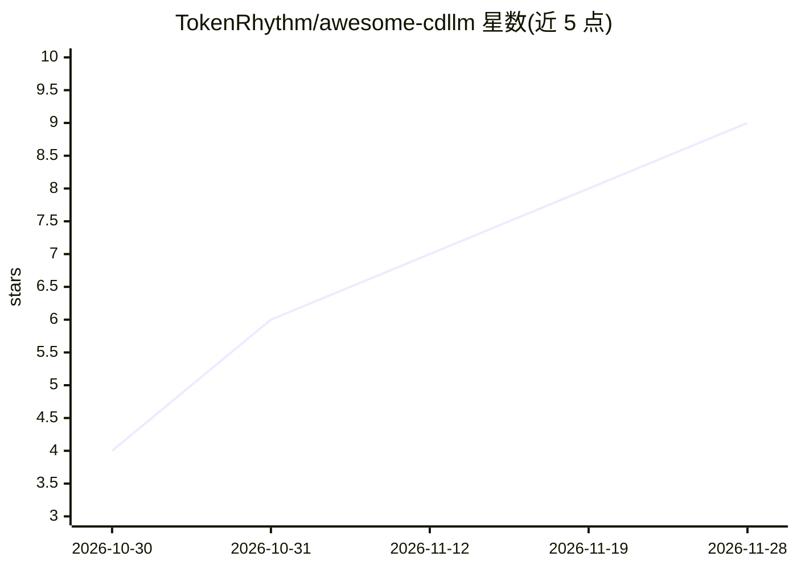

# TokenRhythm/awesome-cdllm

⭐ 9 · Python · CC0-1.0 · 推送 2026-11-20 · [GitHub](https://github.com/TokenRhythm/awesome-cdllm) · 组织维护

**连续空间扩散与流语言模型的论文策展清单（354 篇）**

作为综述《Continuous-Space Diffusion and Flow Language Models: A Survey》的配套仓库，收录 354 篇论文，按综述章节组织：基础（扩散/流匹配）、状态、转移、采样与文本接口、任务与评测、开放问题等。提供综述 PDF、BibTeX、核心系统对照表与时间线图，列表更新截至 2026 年 11 月，接受 PR 补充。面向研究 NLP 文本生成与扩散模型的读者。

## 筛选速览

| 维度 | 判定 | 备注 |
|---|---|---|
| AI 角色 | `ai-knowledge` | 知识聚合/清单类 |
| 许可风险 | `viral` | CC0-1.0 |
| 部署形态 | `None` |  |
| 模型依赖 | — | README 未给出锁定关系 |
| 硬件要求 | — | 无带数字的原话,不猜 |
| 安装摩擦 | `low` | 无编译、无系统依赖或容器化 |
| 成熟度 | — | 结构信号不足 |

## 能力要点

- 收录 354 篇论文，结构对齐综述 §2–§7
- 提供核心系统查找表，比较方法配置（state/transition/decoder）
- 含 2022–2026 年代表性系统时间线与分类图

## 适用场景

- 查找连续扩散/流语言模型相关论文
- 按状态、转移、解码器维度对比各方法配置
- 撰写相关综述或课程时引用参考文献

## 场景标签

`精选清单` `科研工具` · 领域:学习与行业

## 证据(README 行号)

> L17:  A curated list of continuous-space diffusion and flow language models : models that generate text by iteratively r
> L18:  This is the companion repository of our survey Continuous-Space Diffusion and Flow Language Models: A Survey , and

## 星数曲线

2026-10-30 4 → 2026-11-28 9（+5）

---
*卡片 v1 · prompt 1.4 · 生成 2026-11-20 · 置信度 high · 依据 README sha `6244048a367a` · [字段定义](../../DATASET.md)*
