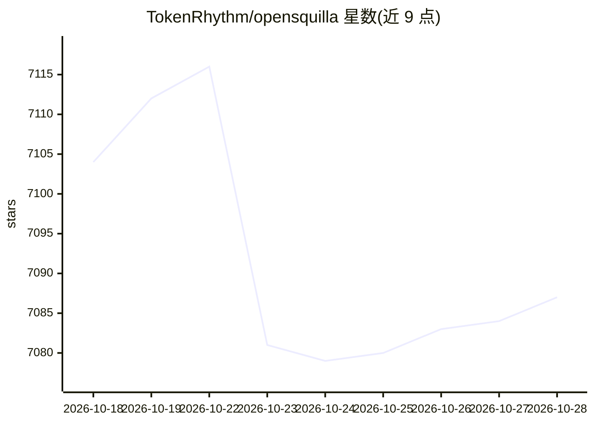

# TokenRhythm/opensquilla

⭐ 7,089 · Python · Apache-2.0 · 推送 2026-10-28 · [GitHub](https://github.com/TokenRhythm/opensquilla) · [官网](https://opensquilla.ai) · 组织维护 · 中文 README

**Token 高效微内核 AI agent：本地模型路由按回合选最便宜可用模型**

面向 CLI、Web UI 与聊天频道的微内核 AI agent：核心机制是本地 SquillaRouter 模型路由器，将每一轮对话发给能处理的最低成本模型，辅以持久记忆、分层沙箱、内置网络搜索与端侧 embeddings，所有入口共享同一回合循环。可插拔 provider 层接入 TokenRhythm、OpenRouter、OpenAI、Anthropic、Ollama、DeepSeek、Gemini、通义千问/DashScope 等 20+ 供应商。当前稳定版 0.5.6，提供桌面安装包（macOS arm64 / Windows x64）、uv wheel 安装与源码安装三条路径；终端安装路径在 Windows/macOS 上可能需手动补装 VC++ 运行库或 libomp（缺失时回退单模型直连路由）。

## 筛选速览

| 维度 | 判定 | 备注 |
|---|---|---|
| AI 角色 | `ai-native` | 本体是模型或模型工具 |
| 许可风险 | `permissive` | Apache-2.0 |
| 部署形态 | `desktop` | 安装包/桌面程序 |
| 模型依赖 | local-ok | 支持本地模型 |
| 硬件要求 | — | 无带数字的原话,不猜 |
| 安装摩擦 | `low` | 无编译、无系统依赖或容器化 |
| 成熟度 | — | 结构信号不足 |

## 能力要点

- 本地 SquillaRouter 按回合路由到最低成本可用模型，附带 ONNX/LightGBM 运行时
- 可插拔 provider 层支持 OpenAI/Anthropic/Ollama/DeepSeek/Gemini 等 20+ 供应商，配置 schema 不变
- CLI、Web UI、聊天频道（飞书/Telegram/DingTalk/QQ/企业微信/Slack/Discord 等）共用同一回合循环与决策日志
- 持久记忆、分层沙箱、内置网络搜索与端侧 embeddings

## 适用场景

- 在 CLI 或桌面端用同一个 agent 覆盖多种 LLM 供应商并控制 token 成本
- 通过飞书/Telegram/DingTalk 等聊天频道使用 agent 功能
- 让日常 agent 流量经路由器积累数据形成自我改进的路由策略

## 场景标签

`模型网关` `AI 助手` · 领域:Agent 开发

## 证据(README 行号)

> L24: OpenSquilla is a token-efficient, microkernel AI agent. A local model
> L25: router sends each turn to the cheapest model that can handle it, while
> L32: TokenRhythm, OpenRouter, OpenAI, Anthropic, Ollama, DeepSeek, Gemini,

## 星数曲线

2026-10-18 7,104 → 2026-10-28 7,087（-17）

---
*卡片 v1 · prompt 1.4 · 生成 2026-10-20 · 置信度 mid · 依据 README sha `c8e8ba139dac` · [字段定义](../../DATASET.md)*
