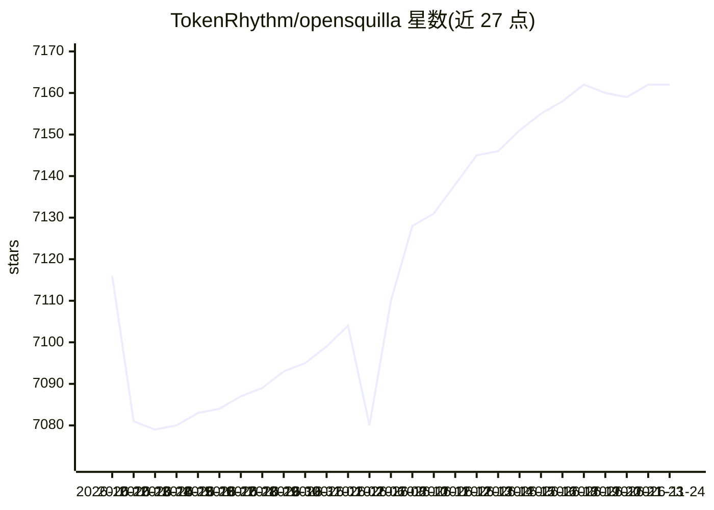

# TokenRhythm/opensquilla

⭐ 7,162 · Python · Apache-2.0 · 推送 2026-11-22 · [GitHub](https://github.com/TokenRhythm/opensquilla) · [官网](https://opensquilla.ai) · 组织维护 · 中文 README

**面向 CLI/Web/聊天渠道的省 token 微内核 AI Agent**

OpenSquilla 是一个微内核架构的 AI Agent，提供 CLI、Web UI 与聊天渠道三类入口，统一走同一个共享回合循环。本地模型路由器（SquillaRouter）按每轮对话把请求发给能胜任的最低成本模型；配套持久记忆、分层沙箱、内置网页搜索与端到端嵌入。可插拔 provider 层接 TokenRhythm、OpenRouter、OpenAI、Anthropic、Ollama、DeepSeek 等 20+ 模型服务。支持 Windows/macOS/Linux，桌面安装包、uv 终端安装与源码构建三条路径；Windows 路由器 ONNX 运行时需 Visual C++ 运行时，macOS 终端安装可能需 libomp。Apache 2.0 许可。

## 筛选速览

| 维度 | 判定 | 备注 |
|---|---|---|
| AI 角色 | `ai-ecosystem` | LLM/agent 周边工具 |
| 许可风险 | `permissive` | Apache-2.0 |
| 部署形态 | `desktop` | 安装包/桌面程序 |
| 模型依赖 | local-ok | 支持本地模型 |
| 硬件要求 | — | 无带数字的原话,不猜 |
| 安装摩擦 | `low` | 无编译、无系统依赖或容器化 |
| 成熟度 | — | 结构信号不足 |

## 能力要点

- 本地模型路由器按轮次选择最低成本可用模型
- CLI/Web UI/聊天渠道共用同一回合循环与决策日志
- 可插拔 provider 层支持 20+ LLM 服务商且不改代码与配置
- 多渠道接入：飞书、Telegram、钉钉、QQ、企业微信、Slack、Discord 等

## 适用场景

- 在固定 token 预算下运行个人 AI Agent 日常任务
- 把同一个 Agent 接入飞书/钉钉/Slack 等聊天渠道
- 本地路由多模型服务以降低调用成本

## 场景标签

`模型网关` `Agent 框架` `AI 助手` `聊天机器人` · 领域:Agent 开发

## 证据(README 行号)

> L6:  A microkernel AI agent for your CLI, Web UI, and chat channels.
> L31: identically everywhere. A pluggable provider layer speaks to
> L24: OpenSquilla is a token-efficient, microkernel AI agent. A local model

## 星数曲线

2026-10-22 7,116 → 2026-11-24 7,162（+46）

---
*卡片 v1 · prompt 1.4 · 生成 2026-11-22 · 置信度 high · 依据 README sha `c3c2f2d3d70e` · [字段定义](../../DATASET.md)*
