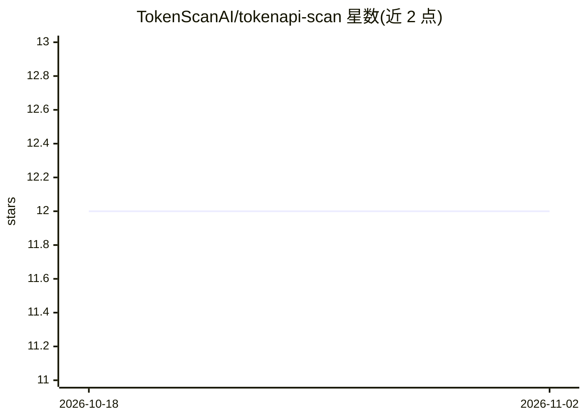

# TokenScanAI/tokenapi-scan

⭐ 12 · Python · NOASSERTION · 推送 2026-09-21 · [GitHub](https://github.com/TokenScanAI/tokenapi-scan) · [官网](https://tokenscanai.com) · 组织维护 · 中文 README

**AI API 中转站真伪与质量检测平台（文档+数据仓库）**

面向使用 AI API 中转/转售服务的开发者：提交 base_url + key + 模型名，托管服务运行约 30–75 秒的加密与行为探测，判定模型是否被偷换、协议响应是否伪造、token 计费是否虚报，生成可分享报告；重复检测汇入贝叶斯加权重榜。本仓库为公共文档枢纽（MIT）：方法论、字段字典、安全与独立性政策，以及每日刷新的 224 家中转站机器可读目录（relay-catalog.json），另提供零依赖 Python CLI 与只读 JSON API。检测引擎本身不在此仓库，以托管服务形式运行。

## 筛选速览

| 维度 | 判定 | 备注 |
|---|---|---|
| AI 角色 | `ai-ecosystem` | LLM/agent 周边工具 |
| 许可风险 | `permissive` | NOASSERTION |
| 部署形态 | `None` |  |
| 模型依赖 | — | README 未给出锁定关系 |
| 硬件要求 | — | 无带数字的原话,不猜 |
| 安装摩擦 | `low` | 无编译、无系统依赖或容器化 |
| 成熟度 | — | 结构信号不足 |

## 能力要点

- Claude 11 项检测：校验 extended-thinking 加密签名（权重 25%），Bedrock 代理无法复现
- 贝叶斯加权重榜，按样本量而非单次结果评判中转站
- 每日刷新的 224 家 CN 中转站机器可读目录（信任等级+价格）
- 零依赖 tokenscan CLI 与免鉴权只读 JSON API（31 端点 OpenAPI）

## 适用场景

- 购买中转 API 前检测模型真伪与计费诚实度
- 在 agent 或 MCP 工具中按模型查询路由候选与信任等级
- 引用可复现的加密证据举报伪造响应的中转站

## 场景标签

`模型评测` `精选清单` · 领域:评测与运维

## 证据(README 行号)

> L16: **TokenAPI Scan** (token照妖镜) is an independent, third-party detection platform for **AI API relay services** — prox
> L49: 1. You submit `base_url + key + model` on <https://tokenscanai.com> (no key is stored — destroyed after the run).
> L68: |`data/relay-catalog.json`|**Open data node** — machine-readable catalog of 224 CN AI API relays with trust level, 

## 星数曲线

2026-10-18 12 → 2026-11-02 12（+0）

---
*卡片 v1 · prompt 1.4 · 生成 2026-11-01 · 置信度 high · 依据 README sha `ffc53e76a6a0` · [字段定义](../../DATASET.md)*
