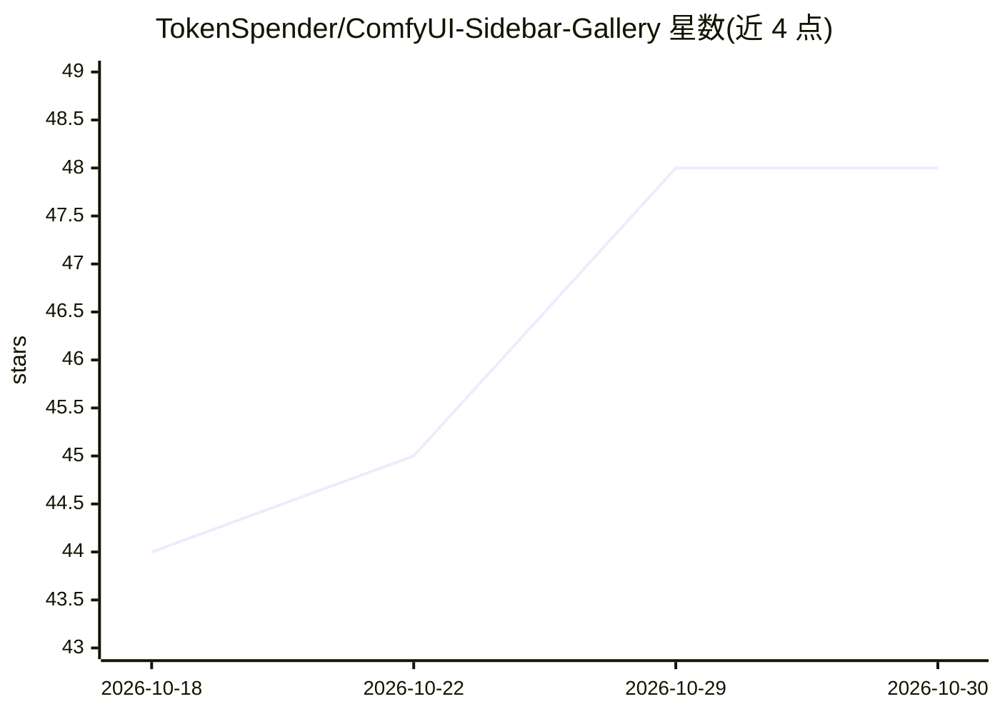

# TokenSpender/ComfyUI-Sidebar-Gallery

⭐ 48 · JavaScript · MIT · 推送 2026-10-10 · [GitHub](https://github.com/TokenSpender/ComfyUI-Sidebar-Gallery) · 个人维护

**ComfyUI 侧边栏媒体画廊：索引产物并读取生成元数据**

ComfyUI 扩展，在侧边栏添加媒体浏览器：索引 output 及自选文件夹中的图片、视频、音频到 SQLite 数据库，读取 ComfyUI、Automatic1111、Forge、SD.Next、Fooocus、CivitAI 嵌入的生成元数据并以结构化面板展示。ComfyUI 文件解析工作流图而非扁平参数串，可解析节点传入的实际值；支持全库元数据搜索（前缀限定、排除词、AND/OR）、收藏、对比、拖拽加载工作流，以及元数据面板布局与主题的自定义编辑。设置由 ComfyUI 本地后端保存，不上传。

## 筛选速览

| 维度 | 判定 | 备注 |
|---|---|---|
| AI 角色 | `ai-ecosystem` | LLM/agent 周边工具 |
| 许可风险 | `permissive` | MIT |
| 部署形态 | `None` |  |
| 模型依赖 | — | README 未给出锁定关系 |
| 硬件要求 | — | 无带数字的原话,不猜 |
| 安装摩擦 | `low` | 无编译、无系统依赖或容器化 |
| 成熟度 | — | 结构信号不足 |

## 能力要点

- SQLite 索引数万级文件库，浏览与搜索保持快速
- ComfyUI 文件按工作流图解析，解析节点传入的实际值
- 全库元数据搜索：前缀限定字段、减号排除、AND/OR 组合、可保存搜索
- 元数据面板布局、主题、预设、快捷键均可自定义编辑

## 适用场景

- 在 ComfyUI 内浏览和检索历史生成的图片、视频、音频
- 查看作品的生成参数（checkpoint、LoRA、采样器、提示词等）
- 对比两次生成的参数差异，或将缩略图拖回画布加载工作流

## 场景标签

 · 领域:AI 图像生成/工具

## 证据(README 行号)

> L9: Sidebar Gallery is a ComfyUI extension that adds a media browser to the sidebar. It indexes the images, videos, and 
> L80: **ComfyUI-Manager (recommended):** open ComfyUI-Manager, search the custom-node list for **Sidebar Gallery**, insta

## 星数曲线

2026-10-18 44 → 2026-10-30 48（+4）

---
*卡片 v1 · prompt 1.4 · 生成 2026-10-25 · 置信度 high · 依据 README sha `8ccba599228a` · [字段定义](../../DATASET.md)*
