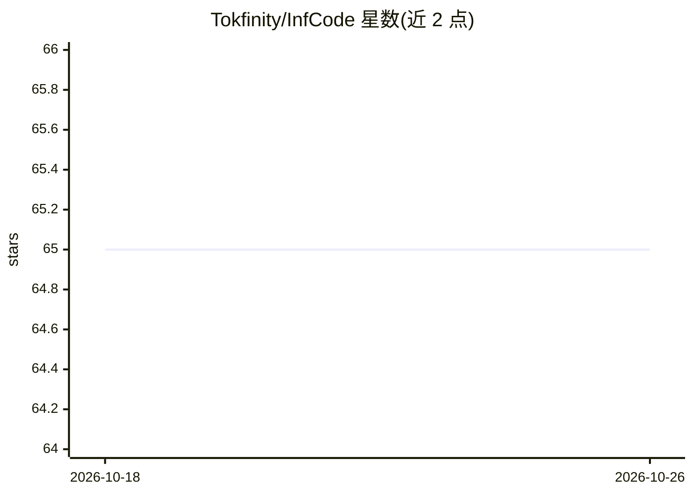

# Tokfinity/InfCode

⭐ 65 · Python · MIT · 推送 2025-11-25 · [GitHub](https://github.com/Tokfinity/InfCode) · [官网](https://www.tokfinity.com/infcode) · 组织维护 · 中文 README

**双 agent 对抗式代码仓库 issue 自动修复系统**

由 Tokfinity 代码研究团队与北京航空航天大学开发的对抗式多 agent Code Agent 系统：用 LLM 自动分析并修复代码仓库 issue。核心为 Patch Generator 与 Patch Selector 双模块，Generator 内含测试补丁生成器与代码补丁生成器，在对抗循环中迭代增强测试与修复代码；补丁在容器内生成并经强化测试集验证。LLM API Manager 支持 OpenAI、OpenRouter、DeepSeek 及自部署模型。运行依赖 Docker 与 Python 3.12+，官方 SWE-bench 工具评测，论文见 arXiv:2511.16004。

## 筛选速览

| 维度 | 判定 | 备注 |
|---|---|---|
| AI 角色 | `ai-native` | 本体是模型或模型工具 |
| 许可风险 | `permissive` | MIT |
| 部署形态 | `library` | 以包/库形式分发 |
| 模型依赖 | locked-api |  |
| 硬件要求 | — | 无带数字的原话,不猜 |
| 安装摩擦 | `low` | 无编译、无系统依赖或容器化 |
| 成熟度 | — | 结构信号不足 |

## 能力要点

- 测试/代码双 agent 对抗循环迭代改进补丁
- 每组生成器独立容器并行生成多个候选补丁
- 统一 LLM API Manager 支持 OpenAI/OpenRouter/DeepSeek 及自部署模型
- 内置 File Editor/File Search/Bash Executor 等容器内工具与失败自动分析工具

## 适用场景

- 自动分析并修复代码仓库中的 issue 生成补丁
- 在 SWE-bench 类基准上批量运行与评测补丁
- 对补丁生成失败案例做根因分析

## 场景标签

`多智能体` `编码 Agent` · 领域:Agent 开发

## 证据(README 行号)

> L5: InfCode is an adversarial multi-agent Code Agent System developed by Tokfinity's Code Research team & Beihang Univer
> L21:  - The Generator internally contains two agents: a **Test Patch Generator** and a **Code Patch Generator**, that it

## 星数曲线

2026-10-18 65 → 2026-10-26 65（+0）

---
*卡片 v1 · prompt 1.4 · 生成 2026-10-24 · 置信度 high · 依据 README sha `c6d4538b8a88` · [字段定义](../../DATASET.md)*
