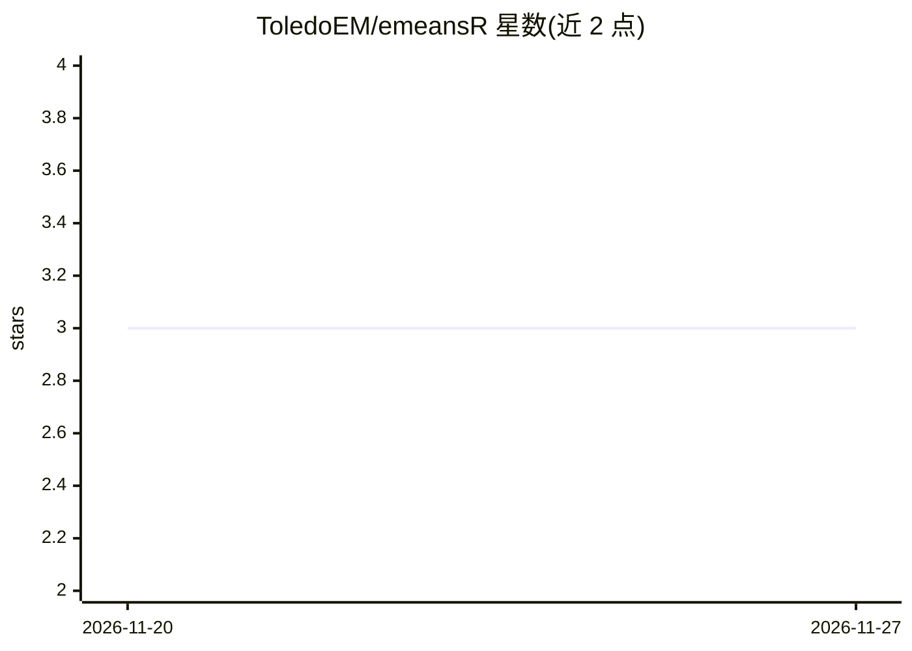

# ToledoEM/emeansR

⭐ 3 · R · NOASSERTION · 推送 2026-11-15 · [GitHub](https://github.com/ToledoEM/emeansR) · [官网](https://toledoem.github.io/emeansR/) · 个人维护

**R 包：为大数据集提供 e-means 聚类实现**

R 实现的 e-means 算法（Bessa et al., 2026, arXiv:2611.09501），作为 Lloyd k-means 的 mini-batch 替代：每个质心按 mini-batch 均值做指数移动平均，由拟合的 scaling laws 确定 batch size 与步长，用户只需提供数据、k 与 epoch 预算。计算核心用 Rust 编写并在 CPU 上多线程运行。返回对象继承 kmeans 类，附带余弦相似度聚类、float32 精度、分块流式训练等选项，README 含基准测试与 Seurat 集成示例。安装需 Rust 工具链。

## 筛选速览

| 维度 | 判定 | 备注 |
|---|---|---|
| AI 角色 | `ai-native` | 本体是模型或模型工具 |
| 许可风险 | `permissive` | NOASSERTION |
| 部署形态 | `None` |  |
| 模型依赖 | — | README 未给出锁定关系 |
| 硬件要求 | — | 无带数字的原话,不猜 |
| 安装摩擦 | `low` | 无编译、无系统依赖或容器化 |
| 成熟度 | — | 结构信号不足 |

## 能力要点

- Rust 多线程 CPU 计算核心，随包分发无需网络
- 支持余弦相似度聚类、float32 精度与分块流式训练
- 返回对象继承 R 原生 kmeans 类，接口兼容
- 提供 Seurat 单细胞工作流集成示例

## 适用场景

- 对大规模数据做 k-means 式聚类
- 单细胞 RNA-seq 数据在 Seurat 流程后做细胞聚类
- 内存装不下的数据用分块流式方式训练

## 场景标签

 · 领域:机器学习/数据科学工具

## 证据(README 行号)

> L10: An R implementation of e-means (Bessa et al., 2026, arXiv:2611.09501), a mini-batch replacement for Lloyd's k-means
> L12: The compute core (nearest-centroid assignment and the EMA updates) is Rust, multi-threaded on the CPU. The training

## 星数曲线

2026-11-20 3 → 2026-11-27 3（+0）

---
*卡片 v1 · prompt 1.4 · 生成 2026-11-22 · 置信度 high · 依据 README sha `570cd5eedf90` · [字段定义](../../DATASET.md)*
