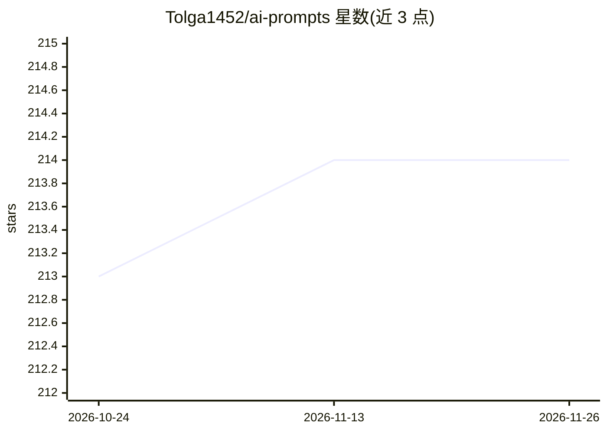

# Tolga1452/ai-prompts

⭐ 214 · TypeScript · 推送 2026-10-27 · [GitHub](https://github.com/Tolga1452/ai-prompts) · 个人维护

**收录各家 AI 聊天机器人系统提示词与工具数据的集合**

以目录形式组织各家 AI 聊天机器人的原始系统提示词与工具数据，覆盖 Apple Intelligence、bolt.new、ChatGPT、Claude、Gemini、Grok、GitHub Copilot、Lovable、v0 等产品，按类别与版本分层列出。提示词多数直接提取自聊天机器人本体，README 声明不保证完全准确且可能过时；变量信息以占位符替换并由 variables.json 列出，附 CHANGELOG 与 STATS 跟踪更新与统计。

## 筛选速览

| 维度 | 判定 | 备注 |
|---|---|---|
| AI 角色 | `ai-knowledge` | 知识聚合/清单类 |
| 许可风险 | `none` | — |
| 部署形态 | `None` |  |
| 模型依赖 | — | README 未给出锁定关系 |
| 硬件要求 | — | 无带数字的原话,不猜 |
| 安装摩擦 | `low` | 无编译、无系统依赖或容器化 |
| 成熟度 | — | 结构信号不足 |

## 能力要点

- 按产品与版本组织的系统提示词目录，标注新增/更新/已下线条目
- 变量以占位符替换，variables.json 列出全部变量
- CHANGELOG.md 记录更新，STATS.md 提供提示词统计
- Credits 区注明各条提示词的来源仓库

## 适用场景

- 研究各家聊天机器人的系统提示词写法
- 为自己构建聊天机器人时参考工具数据结构
- 跟踪某产品提示词随版本的变动

## 场景标签

`提示工程` `精选清单` · 领域:Agent 开发

## 证据(README 行号)

> L3: A collection of original system prompts and tool data used for AI chatbots.
> L17: ## Categories
> L157: ## Credits

## 星数曲线

2026-10-24 213 → 2026-11-26 214（+1）

---
*卡片 v1 · prompt 1.4 · 生成 2026-11-25 · 置信度 high · 依据 README sha `9b914ab03e26` · [字段定义](../../DATASET.md)*
