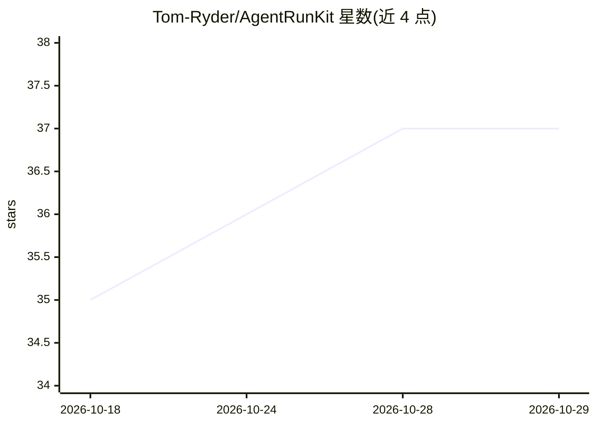

# Tom-Ryder/AgentRunKit

⭐ 37 · Swift · MIT · 推送 2026-09-26 · [GitHub](https://github.com/Tom-Ryder/AgentRunKit) · 个人维护

**给 Swift 开发者的类型安全 LLM agent 构建 SDK**

Swift 6 SDK，用于构建带类型安全工具调用的 LLM agent：提供可配置迭代与 token 预算的 agent 循环、流式输出、子 agent 组合、上下文管理、检查点恢复、human-in-the-loop 工具审批、结构化输出与多模态输入。支持多家云提供商客户端，并可通过 MLX 目标（链接 mlx-swift-lm）和 Apple Foundation Models 在 Apple Silicon 上做本地推理。核心零依赖，通过 Swift Package Manager 安装，要求 iOS 18+/macOS 15+/Swift 6.1+，附一个可运行的终端编码 agent 示例。

## 筛选速览

| 维度 | 判定 | 备注 |
|---|---|---|
| AI 角色 | `ai-ecosystem` | LLM/agent 周边工具 |
| 许可风险 | `permissive` | MIT |
| 部署形态 | `None` |  |
| 模型依赖 | local-ok | 支持本地模型 |
| 硬件要求 | — | 无带数字的原话,不猜 |
| 安装摩擦 | `low` | 无编译、无系统依赖或容器化 |
| 成熟度 | — | 结构信号不足 |

## 能力要点

- 类型安全工具调用，编译期 JSON schema 校验
- 云（OpenAI/Anthropic/Gemini/Vertex 等）与本地（MLX、Foundation Models）推理通道
- 检查点恢复、上下文自动压缩与 token 预算管理
- MCP 客户端（stdio 传输、工具发现、JSON-RPC）

## 适用场景

- 在 iOS/macOS 应用中集成带工具调用的 agent
- 构建支持流式输出与人工审批的编码/工作流 agent
- 在 Apple Silicon 设备上离线运行 LLM agent

## 场景标签

`Agent 框架` `Agent 记忆` · 领域:Agent 开发

## 证据(README 行号)

> L13:  A Swift 6 SDK for building LLM-powered agents with type-safe tool calling.
> L65: - `AgentRunKitMLX` for MLX on Apple Silicon (links mlx-swift-lm)

## 星数曲线

2026-10-18 35 → 2026-10-29 37（+2）

---
*卡片 v1 · prompt 1.4 · 生成 2026-10-25 · 置信度 high · 依据 README sha `f6a209f34aae` · [字段定义](../../DATASET.md)*
