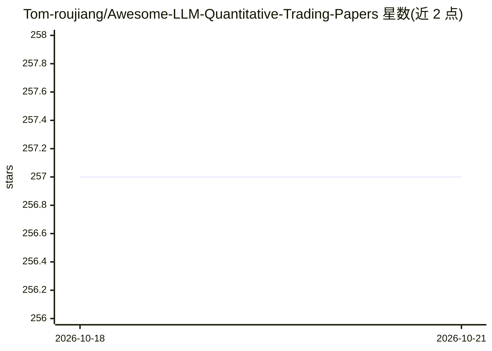

# Tom-roujiang/Awesome-LLM-Quantitative-Trading-Papers

⭐ 257 · NOASSERTION · 推送 2026-07-24 · [GitHub](https://github.com/Tom-roujiang/Awesome-LLM-Quantitative-Trading-Papers) · 个人维护

**LLM 量化交易论文与基准的策展清单，面向量化/金融 AI 研究者**

由个人维护的 awesome 清单，收录大语言模型用于量化交易与投资研究的论文、基准、工具与综述。条目按 Trading Agents、金融基准、竞技场、LLM 后训练、股票预测、因子挖掘、预测、综述等类别组织，每条标注机构、时间与 Paper/Code 链接。收录范围要求与 LLM + 量化金融明确相关，排除纯金融或纯 LLM 资源、营销页与付费产品。项目采用 CC BY 4.0 许可，接受社区按格式贡献。

## 筛选速览

| 维度 | 判定 | 备注 |
|---|---|---|
| AI 角色 | `ai-knowledge` | 知识聚合/清单类 |
| 许可风险 | `none` | NOASSERTION |
| 部署形态 | `None` |  |
| 模型依赖 | — | README 未给出锁定关系 |
| 硬件要求 | — | 无带数字的原话,不猜 |
| 安装摩擦 | `low` | 无编译、无系统依赖或容器化 |
| 成熟度 | — | 结构信号不足 |

## 能力要点

- 按 8+ 个类别组织 LLM 量化交易论文与基准条目
- 每条含机构、发表时间及 Paper/Code 链接
- 明确的收录范围政策与贡献指南

## 适用场景

- 查找 LLM 量化交易方向的最新论文与基准
- 调研交易 Agent、因子挖掘、金融评测等子方向的研究进展
- 为选型或综述收集可复现的代码仓库线索

## 场景标签

`精选清单` `金融量化` · 领域:学习与行业

## 证据(README 行号)

> L6: A curated list of research papers, benchmarks, tools, and resources about large language models for quantitative tra
> L80: This list focuses on resources where large language models, multimodal language models, or LLM-based agents are use

## 星数曲线

2026-10-18 257 → 2026-10-21 257（+0）

---
*卡片 v1 · prompt 1.4 · 生成 2026-10-22 · 置信度 high · 依据 README sha `2b019e3f11a0` · [字段定义](../../DATASET.md)*
