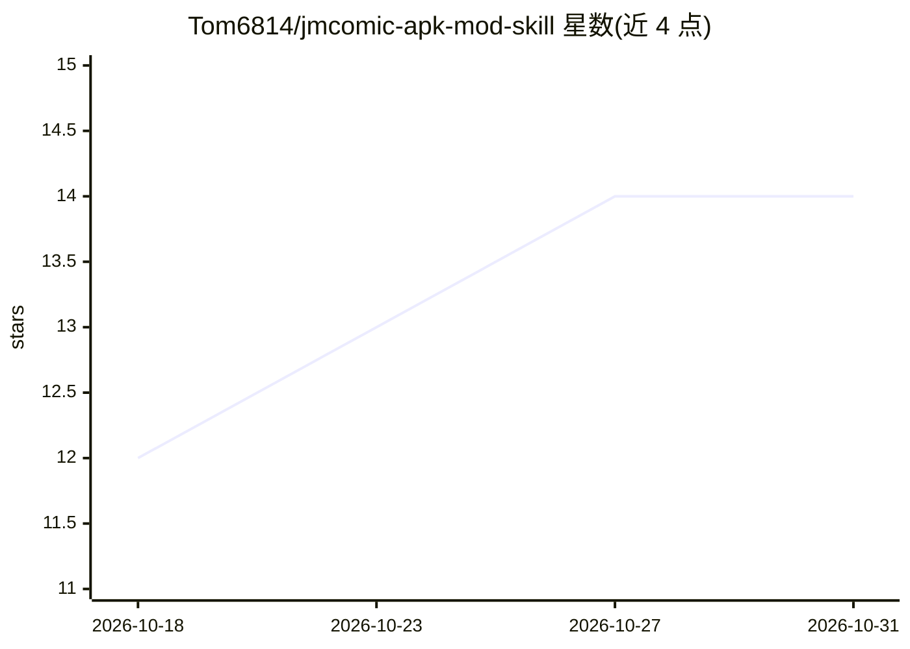

# Tom6814/jmcomic-apk-mod-skill

⭐ 14 · 推送 2026-08-28 · [GitHub](https://github.com/Tom6814/jmcomic-apk-mod-skill) · 个人维护 · 中文 README

**面向 LLM 的 APK 逆向修改知识文档：自动化去广告**

一份接入 AI 编程工具的 Skill 文件（SKILL.md，805 行）：包含 JMComic3 Android APK 去广告与移除游戏/电影板块的逆向修改知识，覆盖 Webpack 分块分析、广告链路追踪、孤儿 chunk 清理与验证清单，含两种使用分支（仅去广告/去广告+去板块）。使用方式为克隆仓库并将 SKILL.md 放入 Trae、Cursor 等工具的 Skill 目录；也可作为纯手动逆向手册参考。声明仅用于学习研究，禁止商业分发。

## 筛选速览

| 维度 | 判定 | 备注 |
|---|---|---|
| AI 角色 | `ai-knowledge` | 知识聚合/清单类 |
| 许可风险 | `none` | — |
| 部署形态 | `None` |  |
| 模型依赖 | — | README 未给出锁定关系 |
| 硬件要求 | — | 无带数字的原话,不猜 |
| 安装摩擦 | `low` | 无编译、无系统依赖或容器化 |
| 成熟度 | — | 结构信号不足 |

## 能力要点

- 805 行 SKILL.md 知识文档，接入 LLM 后自动执行 APK 逆向修改
- 两种修改分支：仅去广告 / 去广告+移除游戏电影板块
- 内置误伤防护：禁止触碰区域清单与分支验证 Checklist（9+8 项）
- 可脱离 AI 作为手动逆向手册使用，含 Python 脚本模板

## 适用场景

- 在 AI 编程工具中自动完成漫画 APK 去广告修改
- 参考广告链路追踪与 Webpack chunk 分析方法手动改包
- 学习 APK 逆向修改的系统化流程与避坑经验

## 场景标签

`教程课程` · 领域:学习与行业

## 证据(README 行号)

> L6: 一个**面向 AI 编程工具的 Skill 包**，用于自动化完成 JMComic3 Android APK 的逆向修改任务：去除广告、移除游戏/电影板块。
> L10: 这是一个 **AI Skill 文件**——一份系统化的指令和知识文档，接入支持 Skill 机制的大语言模型（LLM）或 AI 编程工具后，可以让 AI 自动完成以下工作：

## 星数曲线

2026-10-18 12 → 2026-10-31 14（+2）

---
*卡片 v1 · prompt 1.4 · 生成 2026-10-31 · 置信度 high · 依据 README sha `2211ed4c60d5` · [字段定义](../../DATASET.md)*
