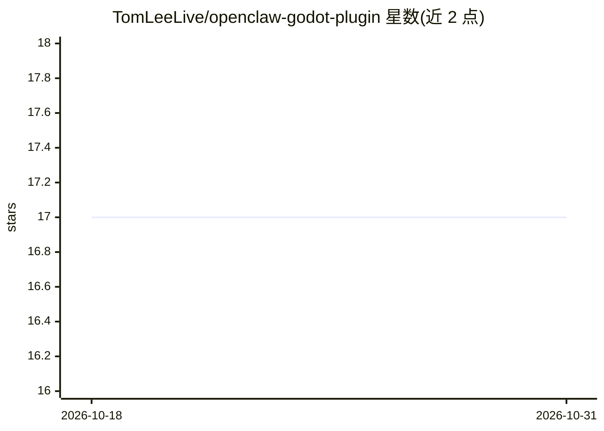

# TomLeeLive/openclaw-godot-plugin

⭐ 17 · GDScript · Apache-2.0 · 推送 2026-09-02 · [GitHub](https://github.com/TomLeeLive/openclaw-godot-plugin) · 个人维护

**让 AI agent 通过 30 个 MCP 工具远程操控 Godot 编辑器的插件**

Godot 4.x 编辑器插件，向 OpenClaw 或任意 MCP 兼容客户端（Claude Code、Cursor 等）暴露 30 个工具：场景管理、节点增删改（80+ 类型）、变换设置、播放控制、截图、场景树查看、控制台日志、键鼠与动作输入模拟、GDScript 读取、资源列表。提供两种连接模式：OpenClaw 网关（远程/Telegram/Discord 聊天集成）与 MCP 直连（仅 127.0.0.1）。支持 Editor 与 Play 模式下保持连接，默认地址 localhost:18789。仅测试于 Godot 4.6-stable，自称 beta；MCP 桥接提供浏览器来源拒绝与可选共享密钥认证。

## 筛选速览

| 维度 | 判定 | 备注 |
|---|---|---|
| AI 角色 | `ai-ecosystem` | LLM/agent 周边工具 |
| 许可风险 | `permissive` | Apache-2.0 |
| 部署形态 | `library` | 以包/库形式分发 |
| 模型依赖 | — | README 未给出锁定关系 |
| 硬件要求 | — | 无带数字的原话,不猜 |
| 安装摩擦 | `low` | 无编译、无系统依赖或容器化 |
| 成熟度 | `idea` | |

## 能力要点

- 30 个 MCP 工具覆盖场景、节点、调试、输入模拟等编辑器操作
- OpenClaw 网关（远程/聊天）与 MCP 直连（本地）双模式
- Editor 与 Play 模式下均保持连接（心跳 30 秒自动重连）
- MCP 桥接含浏览器来源拒绝与可选共享密钥认证

## 适用场景

- 用 AI agent 在 Godot 编辑器里创建场景和节点而无需手动操作
- 远程通过 Telegram/Discord 聊天驱动 Godot 开发与调试
- 让 AI 模拟键鼠输入自动测试游戏

## 场景标签

`编码 Agent` · 领域:编码与开发

## 证据(README 行号)

> L7: Connect Godot 4.x to OpenClaw AI assistant via HTTP. Works in **Editor mode** without hitting Play!
> L37: ### Mode B: MCP Direct (Local Development)
> L165: ## Available Tools (30 tools, 80+ node types)

## 星数曲线

2026-10-18 17 → 2026-10-31 17（+0）

---
*卡片 v1 · prompt 1.4 · 生成 2026-10-29 · 置信度 mid · 依据 README sha `02886d238ae1` · [字段定义](../../DATASET.md)*
