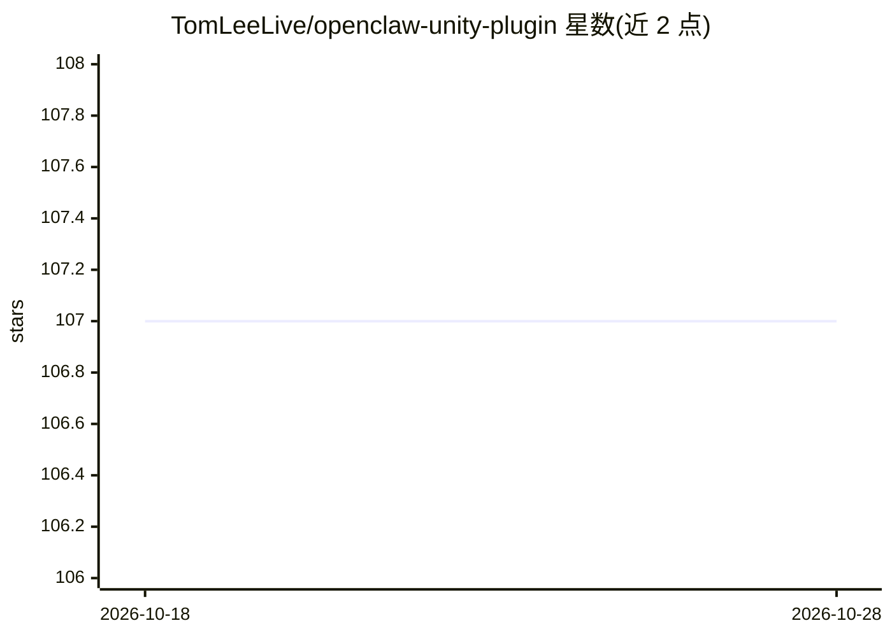

# TomLeeLive/openclaw-unity-plugin

⭐ 107 · C# · Apache-2.0 · 推送 2026-09-08 · [GitHub](https://github.com/TomLeeLive/openclaw-unity-plugin) · 个人维护

**让 MCP 兼容 AI agent 远程操控 Unity 编辑器的工具插件**

Unity 编辑器插件，通过 OpenClaw 网关或 MCP 直连两种模式，向 AI agent 暴露约 55-100 个工具：场景/GameObject/组件/材质/Prefab/资源管理、控制台日志读取、脚本执行、输入模拟、测试运行、打包与批量执行等，Editor 模式下即可操作。网关模式支持 Telegram/Discord 远程访问与定时任务；MCP 模式仅限本机 127.0.0.1。v1.7.0 起本地桥接以每次启动的随机令牌认证。处于 beta 阶段，仅在 Unity 6.3 LTS 上测试过。

## 筛选速览

| 维度 | 判定 | 备注 |
|---|---|---|
| AI 角色 | `ai-ecosystem` | LLM/agent 周边工具 |
| 许可风险 | `permissive` | Apache-2.0 |
| 部署形态 | `library` | 以包/库形式分发 |
| 模型依赖 | — | README 未给出锁定关系 |
| 硬件要求 | — | 无带数字的原话,不猜 |
| 安装摩擦 | `low` | 无编译、无系统依赖或容器化 |
| 成熟度 | `idea` | |

## 能力要点

- 两种连接模式：OpenClaw 网关远程访问 / MCP 本机直连（兼容 Claude Code、Cursor）
- 覆盖场景、GameObject、组件、材质、Prefab、资产、测试、输入模拟等约 100 个工具
- v1.7.0 起本地桥接用 per-launch 令牌认证，仅绑定 127.0.0.1
- batch.execute 单次调用执行多个工具（宣称 10-100x 性能）

## 适用场景

- 用对话式 AI agent 在 Unity 编辑器中创建和修改场景对象
- 远程通过 Telegram/Discord 操控 Unity 项目
- AI 驱动的 Unity UI 自动化测试与调试

## 场景标签

`GUI 自动化` · 领域:效率与自动化

## 证据(README 行号)

> L7: Connect Unity to OpenClaw AI assistant via HTTP. Works in **Editor mode** without hitting Play!
> L30: Telegram/Discord/Web → OpenClaw Gateway → Unity Plugin
> L39: Claude Code/Desktop → MCP Server → Unity Plugin

## 星数曲线

2026-10-18 107 → 2026-10-28 107（+0）

---
*卡片 v1 · prompt 1.4 · 生成 2026-10-23 · 置信度 mid · 依据 README sha `bf99112acb29` · [字段定义](../../DATASET.md)*
