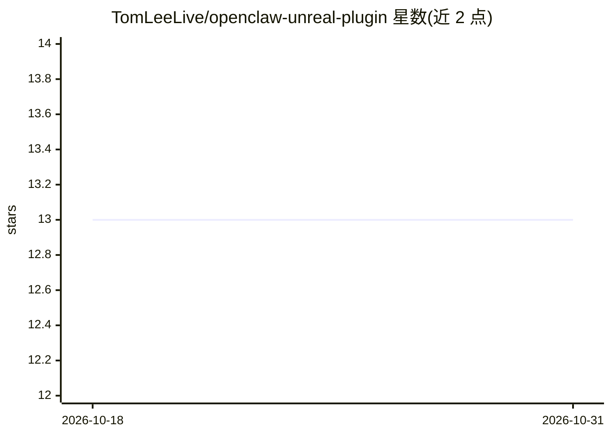

# TomLeeLive/openclaw-unreal-plugin

⭐ 13 · C++ · Apache-2.0 · 推送 2026-09-08 · [GitHub](https://github.com/TomLeeLive/openclaw-unreal-plugin) · 个人维护

**让 MCP 兼容 AI agent 实时控制 Unreal Editor 的插件**

Unreal Engine 插件，通过 Model Context Protocol 暴露 36 个工具，覆盖关卡、Actor、变换、组件、编辑器、调试、输入、资产、控制台与蓝图操作，使任意 MCP 兼容 AI agent 可实时控制 Unreal Editor。提供两种连接模式：经 OpenClaw Gateway 的远程访问（Telegram/Discord/Web）与面向 Claude Code/Cursor 的 MCP 直连（插件内嵌 HTTP 服务器，端口 27184，v1.4.0 起强制每次启动生成的令牌认证，另含 loopback 限制与 nonce 回显）。附可停靠编辑器面板显示连接状态与日志。安装方式为复制插件目录到项目 Plugins/ 并在编辑器中启用。

## 筛选速览

| 维度 | 判定 | 备注 |
|---|---|---|
| AI 角色 | `ai-ecosystem` | LLM/agent 周边工具 |
| 许可风险 | `permissive` | Apache-2.0 |
| 部署形态 | `library` | 以包/库形式分发 |
| 模型依赖 | — | README 未给出锁定关系 |
| 硬件要求 | — | 无带数字的原话,不猜 |
| 安装摩擦 | `low` | 无编译、无系统依赖或容器化 |
| 成熟度 | — | 结构信号不足 |

## 能力要点

- 36 个 MCP 工具覆盖关卡/Actor/组件/资产/控制台/蓝图等编辑器操作
- 双连接模式：OpenClaw Gateway 远程访问与 Claude Code/Cursor MCP 直连可同时运行
- 内嵌 HTTP 服务器以每次启动令牌认证（0600 权限文件，401/403 拒绝匿名与网页探测）
- 命令队列带 nonce 回显，防止本地其他进程冒充编辑器应答

## 适用场景

- 用 Claude Code 或 Cursor 等 AI agent 直接操作 Unreal 编辑器搭建关卡
- 通过 Telegram/Discord/Web 远程驱动 Unreal Editor
- 让 AI 助手执行编辑器控制台命令、导入资产或模拟输入

## 场景标签

 · 领域:游戏开发/AI 工具集成

## 证据(README 行号)

> L3: > MCP (Model Context Protocol) bridge for Unreal Engine — lets AI agents control the Unreal Editor in real time.
> L9: - **36 MCP tools** for level, actor, transform, component, editor, debug, input, asset, console, and blueprint contr
> L11: - **Real-time control** of the Unreal Editor from any MCP-compatible AI agent

## 星数曲线

2026-10-18 13 → 2026-10-31 13（+0）

---
*卡片 v1 · prompt 1.4 · 生成 2026-10-31 · 置信度 mid · 依据 README sha `a838cbe63331` · [字段定义](../../DATASET.md)*
