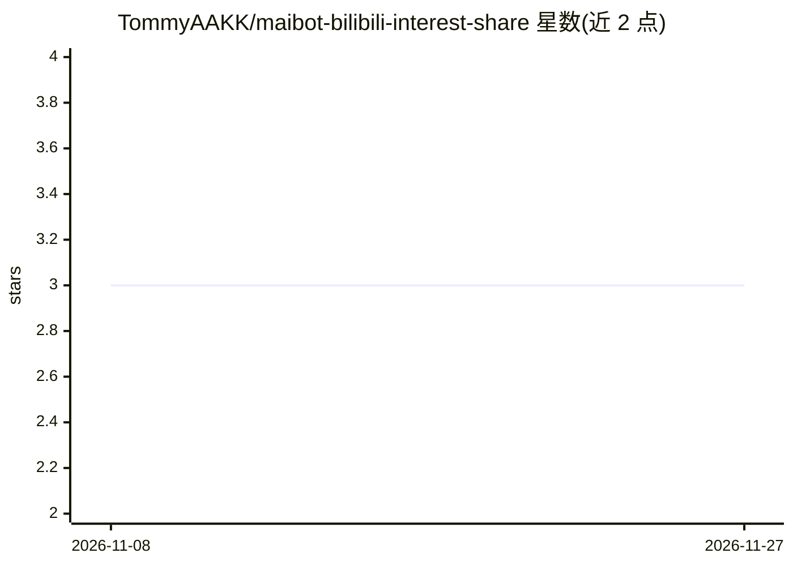

# TommyAAKK/maibot-bilibili-interest-share

⭐ 3 · Python · MIT · 推送 2026-11-01 · [GitHub](https://github.com/TommyAAKK/maibot-bilibili-interest-share) · 个人维护 · 中文 README

**MaiBot 插件：定时刷B站并按群友兴趣用LLM生成人设口吻分享**

MaiBot 框架的插件，定时抓取 B 站视频（关键词搜索/热门/排行榜），从白名单聊天流自动提取兴趣词打分筛选，读取视频标签、字幕、弹幕与热门评论，可选下载视频用 ffmpeg 抽帧后交视觉模型识图，再由文本 LLM 判断并生成符合 MaiBot 人设口吻的分享文案；无 LLM 时退回视频简介原文。支持扫码登录、30 天去重、硬过滤、AI 模板弹幕过滤与自然语言重发。运行于宿主 MaiBot，自身不依赖额外 pip 包。

## 筛选速览

| 维度 | 判定 | 备注 |
|---|---|---|
| AI 角色 | `ai-native` | 本体是模型或模型工具 |
| 许可风险 | `permissive` | MIT |
| 部署形态 | `desktop` | 安装包/桌面程序 |
| 模型依赖 | — | README 未给出锁定关系 |
| 硬件要求 | — | 无带数字的原话,不猜 |
| 安装摩擦 | `medium` | 含编译或系统依赖之一 |
| 成熟度 | — | 结构信号不足 |

## 能力要点

- 从近期聊天自动提取兴趣词并写回配置，手动修改即锁定
- 字幕+弹幕+评论+抽帧识图的多模态深度理解与 LLM 语义判断
- 人设口吻的分享文案生成，无 LLM 时退回简介原文
- 全中文配置与 WebUI 表单，手机扫码登录 B 站

## 适用场景

- 让群聊机器人定时按群友兴趣分享B站视频
- 给 MaiBot 实例增加人设化内容推荐能力
- 过滤官方内容和模板化弹幕，只发有信息量的视频

## 场景标签

`聊天机器人` `AI 写作` `推荐系统` · 领域:对话与助手

## 证据(README 行号)

> L10: 插件会读视频的标签、字幕、弹幕和热门评论，必要时**下载视频抽几帧看画面**，再让 LLM 判断「这视频到底讲了什么、值不值得分享」，最后用**符合人设口吻的自然语言**说出来，像群友随口安利那样。
> L201: |`use_llm_judge`|`true`|LLM 语义判断 + 生成自然语言介绍|
> L55: 文案全部由 LLM 按 MaiBot 的人设口吻生成，**不是模板套话**；没有可用 LLM 时退回视频简介原文，不会发不出去。

## 星数曲线

2026-11-08 3 → 2026-11-27 3（+0）

---
*卡片 v1 · prompt 1.4 · 生成 2026-11-22 · 置信度 mid · 依据 README sha `877b238aa938` · [字段定义](../../DATASET.md)*
