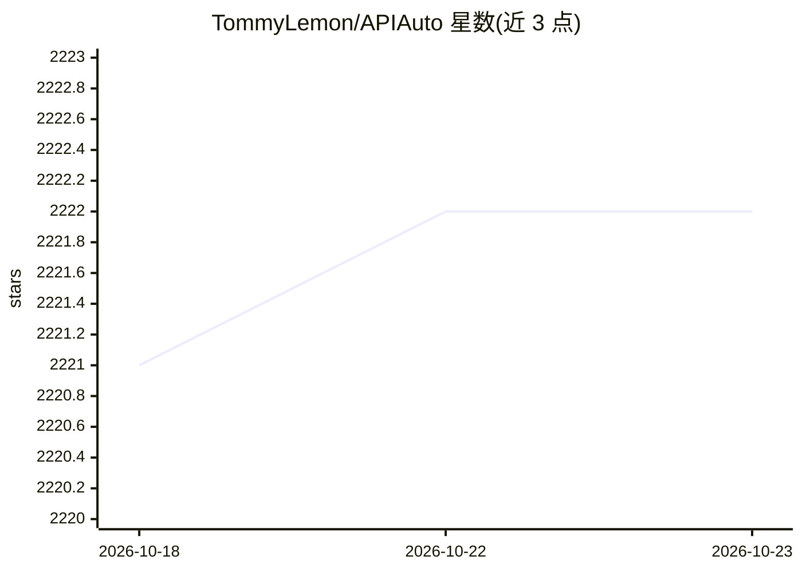

# TommyLemon/APIAuto

⭐ 2,222 · JavaScript · Apache-2.0 · 推送 2026-10-20 · [GitHub](https://github.com/TommyLemon/APIAuto) · [官网](http://apijson.cn/api) · 个人维护 · 中文 README

**带 AI 问答与机器学习测试的 HTTP 接口开发测试工具**

纯静态 SPA 网页形式的 HTTP 接口一站式工具，集合文档生成、接口测试、Mock、调试与用例管理；机器学习部分提供零代码自动测试接口、自动生成多语言前后端代码、静态检查与注释生成，另有 AI 问答。支持从 Postman/Swagger/YApi 一键导入用例与文档，提供 Headless 无 UI 模式通过 HTTP API 集成到 Jenkins 等 CI/CD 流水线。生成文档与用例管理功能需部署 APIJSON 后端。浏览器打开 index.html 即可运行，Headless 模式需 Node 环境。

## 筛选速览

| 维度 | 判定 | 备注 |
|---|---|---|
| AI 角色 | `ai-enhanced` | 去掉 AI 部分产品仍成立 |
| 许可风险 | `permissive` | Apache-2.0 |
| 部署形态 | `library` | 以包/库形式分发 |
| 模型依赖 | — | README 未给出锁定关系 |
| 硬件要求 | — | 无带数字的原话,不猜 |
| 安装摩擦 | `low` | 无编译、无系统依赖或容器化 |
| 成熟度 | — | 结构信号不足 |

## 能力要点

- 机器学习零代码自动测试接口
- 自动生成接口文档、多语言代码与光标悬浮注释
- 从 Postman/Swagger/YApi/Rap 一键导入用例和文档
- Headless 无 UI 模式可通过 HTTP API 集成 CI/CD 流水线

## 适用场景

- 开发和调试 RESTful、类 RESTful、GRPC 接口
- 零代码自动生成接口测试用例并批量回归测试
- 在 CI/CD 流水线中无 UI 执行接口测试

## 场景标签

`代码生成` · 领域:编码与开发

## 证据(README 行号)

> L3:  ☔ HTTP 接口 机器学习零代码测试 和 一站式智能开发管理 工具
> L11: 敏捷开发最强大易用的 HTTP 接口工具，机器学习零代码测试、生成代码与静态检查、生成文档与光标悬浮注释。
> L72: * 自动机器学习零代码测试接口，一键运行

## 星数曲线

2026-10-18 2,221 → 2026-10-23 2,222（+1）

---
*卡片 v1 · prompt 1.4 · 生成 2026-10-21 · 置信度 mid · 依据 README sha `3b07e9c1d97d` · [字段定义](../../DATASET.md)*
