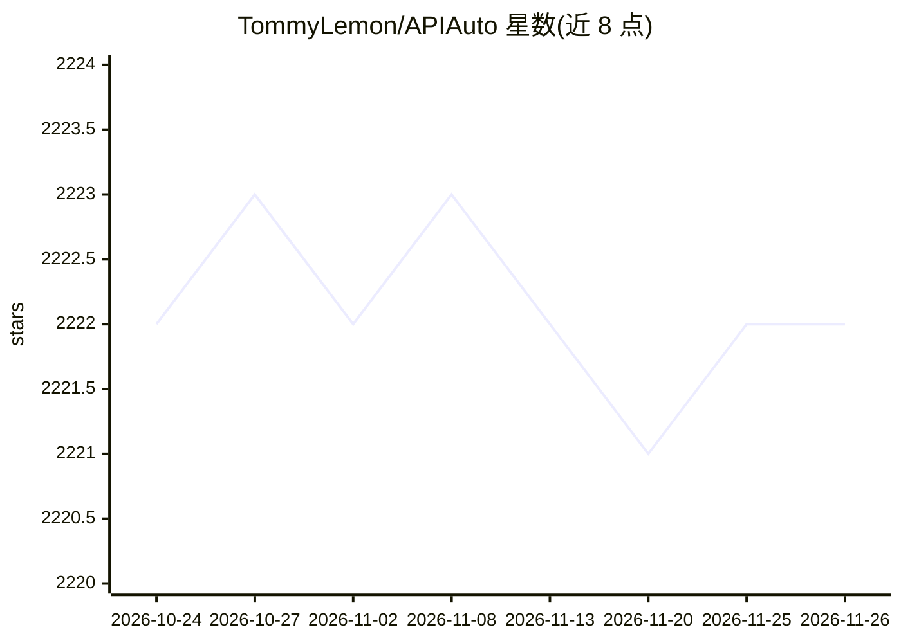

# TommyLemon/APIAuto

⭐ 2,222 · JavaScript · Apache-2.0 · 推送 2026-11-08 · [GitHub](https://github.com/TommyLemon/APIAuto) · [官网](http://apijson.cn/api) · 个人维护 · 中文 README

**机器学习零代码测试 HTTP 接口的一站式工具**

纯静态 SPA 网页形式的 HTTP 接口工具，集合文档、测试、Mock、调试、管理功能；支持机器学习零代码测试接口、自动生成多语言前后端代码与静态检查、自动生成文档与悬浮注释、测试用例管理与一键共享，可从 Postman/Swagger/YApi/Rap 一键导入用例。提供 Headless 无 UI 模式的 HTTP API 以集成 Jenkins 等流水线。文档与用例管理功能需另行部署 APIJSON 后端；第三方不支持 CORS 的接口需开启托管服务代理。

## 筛选速览

| 维度 | 判定 | 备注 |
|---|---|---|
| AI 角色 | `ai-enhanced` | 去掉 AI 部分产品仍成立 |
| 许可风险 | `permissive` | Apache-2.0 |
| 部署形态 | `library` | 以包/库形式分发 |
| 模型依赖 | — | README 未给出锁定关系 |
| 硬件要求 | — | 无带数字的原话,不猜 |
| 安装摩擦 | `low` | 无编译、无系统依赖或容器化 |
| 成熟度 | — | 结构信号不足 |

## 能力要点

- 机器学习零代码测试接口，测试用例自动管理与一键共享
- 自动生成多语言前后端代码、文档与光标悬浮注释
- Headless 无 UI 模式，通过 HTTP API 集成 CI/CD 流水线
- 从 Postman/Swagger/YApi/Rap 等平台一键导入用例和文档

## 适用场景

- 为团队 RESTful 或 GRPC 接口生成文档并管理测试用例
- 把接口回归测试集成到 Jenkins、蓝盾等 CI/CD 流水线
- 调试百度、搜狗等第三方公网 HTTP 接口并录制请求
- 从 Postman/Swagger/YApi 迁移既有接口用例

## 场景标签

 · 领域:开发者工具/API 测试

## 证据(README 行号)

> L3:  ☔ HTTP 接口 机器学习零代码测试 和 一站式智能开发管理 工具
> L72: * 自动机器学习零代码测试接口，一键运行
> L121: 本项目是纯静态 SPA 网页，下载源码解压后：

## 星数曲线

2026-10-24 2,222 → 2026-11-26 2,222（+0）

---
*卡片 v1 · prompt 1.4 · 生成 2026-11-23 · 置信度 mid · 依据 README sha `8d4dc5f62da8` · [字段定义](../../DATASET.md)*
