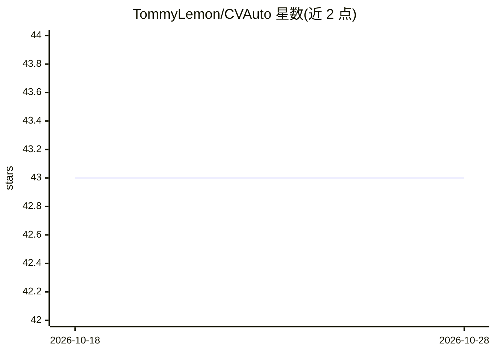

# TommyLemon/CVAuto

⭐ 43 · JavaScript · Apache-2.0 · 推送 2026-10-07 · [GitHub](https://github.com/TommyLemon/CVAuto) · [官网](http://apijson.cn/cv) · 个人维护 · 中文 README

**零代码零标注的计算机视觉 AI 算法自动化测试工具**

纯静态 SPA 网页工具，基于 APIAuto 定制，面向 CV 算法的测试/交付/验收工程师。通过 HTTP API 调用被测推理服务获取检测结果，自动在图上绘制框/点/多边形，无需提前人工标注 Ground Truth；用户可点框纠正误报，工具自动统计召回率、精准率、F1 等指标并对比前后版本效果。支持目标检测、分类、OCR、姿态、分割、人脸识别、旋转校正等算法类型，可一键下载 Excel 测试报告、导出训练/测试数据集，并提供 Headless 无 UI 模式接入 Jenkins 等 CI/CD 流水线。附示例推理服务 AIServer；自动生成文档、测试用例管理需另部署 APIJSON 后端。

## 筛选速览

| 维度 | 判定 | 备注 |
|---|---|---|
| AI 角色 | `ai-ecosystem` | LLM/agent 周边工具 |
| 许可风险 | `permissive` | Apache-2.0 |
| 部署形态 | `library` | 以包/库形式分发 |
| 模型依赖 | — | README 未给出锁定关系 |
| 硬件要求 | — | 无带数字的原话,不猜 |
| 安装摩擦 | `low` | 无编译、无系统依赖或容器化 |
| 成熟度 | — | 结构信号不足 |

## 能力要点

- 无需人工标注，通过 HTTP API 调用推理服务并自动绘制/断言结果
- 自动统计召回率、精准率、F1 Score 并对比前后版本效果
- 一键下载测试报告（Excel）与导出训练/测试数据集
- Headless 无 UI 模式可集成到 Jenkins、蓝盾等 CI/CD 流水线

## 适用场景

- 不写代码、不做标注就测试 CV 识别算法的效果与性能
- 模型迭代时自动对比新旧版本推理结果差异
- 在 CI/CD 流水线中无 UI 回归测试 CV 接口
- 导出纠正后的数据集加速模型迭代训练

## 场景标签

`模型评测` · 领域:评测与运维

## 证据(README 行号)

> L12: **只需上传图片/视频**，一键通过 HTTP API 调用算法模型得到推理后返回的 JSON 响应结果，
> L15: **自动统计**正确数、误报数、漏检数、召回率、精准率、F1 Score 等指标，**自动对比前后效果**。
> L121: 通过调用 HTTP API 即可执行用例和查看进度，方便集成到 CI/CD 流水线。

## 星数曲线

2026-10-18 43 → 2026-10-28 43（+0）

---
*卡片 v1 · prompt 1.4 · 生成 2026-10-25 · 置信度 mid · 依据 README sha `542ca82bd62a` · [字段定义](../../DATASET.md)*
