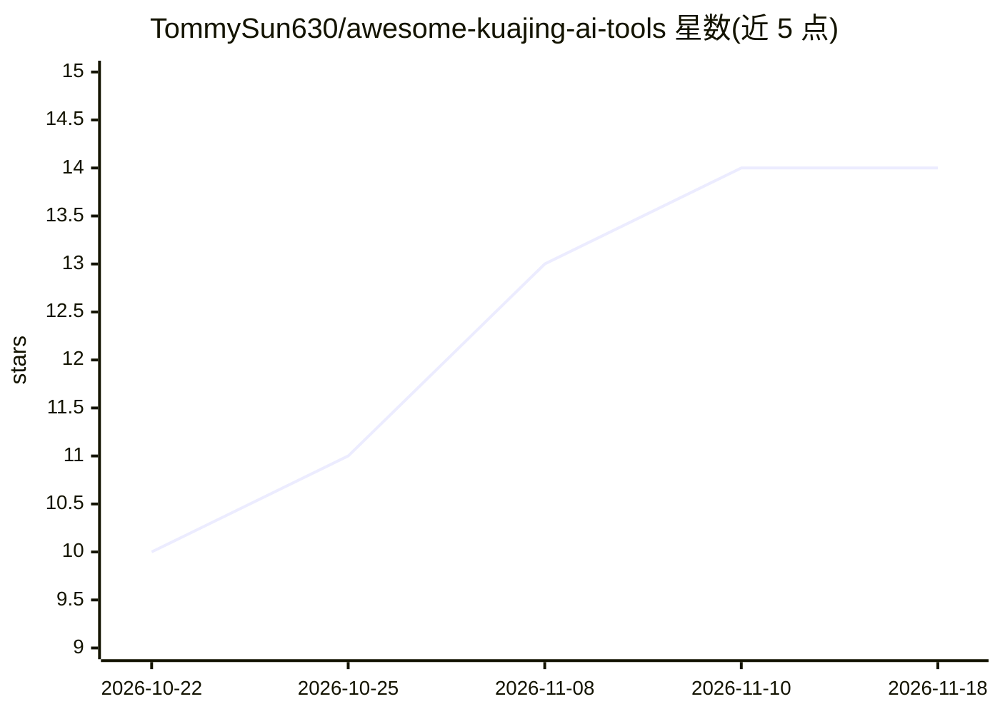

# TommySun630/awesome-kuajing-ai-tools

⭐ 14 · CC0-1.0 · 推送 2026-07-05 · [GitHub](https://github.com/TommySun630/awesome-kuajing-ai-tools) · 个人维护 · 中文 README

**给跨境卖家的 AI 工具分类清单：选品/文案/素材/客服等 7 类**

由个人维护者按实际工作流整理的跨境电商 AI 工具清单，覆盖选品分析、Listing 文案、广告素材、客服机器人、翻译本地化、数据选词、建站辅助 7 个环节，每个条目标注免费/Freemium/付费并附一句用途与坑点说明，末尾给出按预算和平台（亚马逊/独立站/TikTok）组合的最小工具搭配建议。清单以 CC0 许可发布，接受 PR 补充，不收聚合页与联盟短链。仅收录整理第三方工具，本身不提供软件安装或运行方式。

## 筛选速览

| 维度 | 判定 | 备注 |
|---|---|---|
| AI 角色 | `ai-knowledge` | 知识聚合/清单类 |
| 许可风险 | `viral` | CC0-1.0 |
| 部署形态 | `None` |  |
| 模型依赖 | — | README 未给出锁定关系 |
| 硬件要求 | — | 无带数字的原话,不猜 |
| 安装摩擦 | `low` | 无编译、无系统依赖或容器化 |
| 成熟度 | — | 结构信号不足 |

## 能力要点

- 按跨境电商 7 个工作流环节组织工具条目
- 每条标注免费/Freemium/付费并写明适用对象与坑点
- 给出 0 预算/亚马逊/独立站/TikTok 四种场景的最小工具组合表
- 接受 PR，收录规则要求官网链接并禁联盟短链

## 适用场景

- 入门跨境前按环节挑几款工具试用
- 对比同环节竞品（如 Kalodata vs EchoTik）再付费
- 按自己主营平台套用最小工具组合起步

## 场景标签

`精选清单` · 领域:学习与行业

## 证据(README 行号)

> L3: > 一份给跨境卖家用的「AI×跨境」工具清单 —— 不是泛泛的 AI 大全，是真·能用在选品、Listing、广告、客服、本地化上的那些。
> L17: 所以我把自己真金白银试过、或者圈里靠谱的人长期在用的，按**实际工作流**分成 7 类列在这。每条都写一句大白话的「它到底干啥、适合谁、坑在哪」，遇到坑的我也会说。免费的我标 `免费`，有免费额度的标 `Freemium`，纯付费
> L25: |① 选品/市场|不知道卖啥、爆品在哪|扒平台数据、看趋势、挖痛点|Helium 10、Kalodata、VOC AI|

## 星数曲线

2026-10-22 10 → 2026-11-18 14（+4）

---
*卡片 v1 · prompt 1.4 · 生成 2026-11-18 · 置信度 high · 依据 README sha `cfa15678aefb` · [字段定义](../../DATASET.md)*
