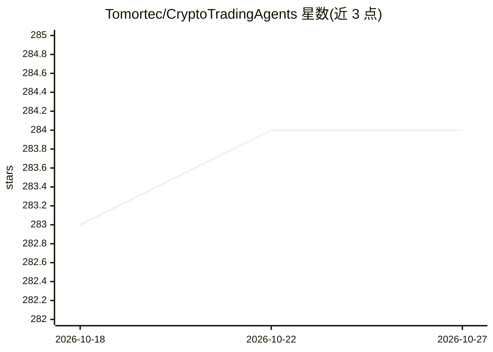

# Tomortec/CryptoTradingAgents

⭐ 284 · Python · Apache-2.0 · 推送 2025-12-22 · [GitHub](https://github.com/Tomortec/CryptoTradingAgents) · [官网](https://arxiv.org/pdf/2412.20138) · 个人维护 · 中文 README

**面向加密货币的多代理 LLM 交易决策分析框架，生成交易研究报告**

基于 TradingAgents 框架（Tauric Research）及 arXiv:2412.20138 论文改造的加密货币交易分析工具：由 Market/Social Media/News/Fundamentals 四类分析师代理协作，从 Binance、CoinDesk、Reddit、taapi.io 等数据源拉取行情、技术指标、新闻与情绪数据，结合 LLM 生成 PDF/Markdown 分析报告。支持自定义投资偏好、导入外部研究报告、结合系统调度器定时生成并通过邮件发送。运行需配置 LLM API key（已测试 Qwen 与 ChatGPT），提供 CLI 交互模式与脚本模式。项目声明仅供研究与教育用途，不构成投资建议。回测/模拟交易（freqtrade 集成）与更多 LLM 支持仍在计划中。

## 筛选速览

| 维度 | 判定 | 备注 |
|---|---|---|
| AI 角色 | `ai-native` | 本体是模型或模型工具 |
| 许可风险 | `permissive` | Apache-2.0 |
| 部署形态 | `library` | 以包/库形式分发 |
| 模型依赖 | — | README 未给出锁定关系 |
| 硬件要求 | — | 无带数字的原话,不猜 |
| 安装摩擦 | `low` | 无编译、无系统依赖或容器化 |
| 成熟度 | — | 结构信号不足 |

## 能力要点

- 四类分析师代理（市场/社媒/新闻/基本面）协作生成交易分析报告
- 整合 Binance、taapi.io、CoinDesk、Reddit 等加密领域数据源
- 支持自定义投资偏好与导入外部研究报告
- CLI 交互模式与脚本模式，可定时生成并邮件发送报告

## 适用场景

- 定时获取 BTC/ETH 等加密资产的 LLM 多代理分析报告
- 按自己的交易风格（激进/长线）定制分析偏好
- 结合外部研报生成综合市场研判

## 场景标签

`金融量化` `多智能体` · 领域:Agent 开发

## 证据(README 行号)

> L13: This project is based on TradingAgents by the Tauric Research team, as well as the paper arxiv.org/pdf/2412.20138.
> L96: 3. **Select Analyst Team** - `Market Analyst`, `Social Media Analyst`, `News Analyst` and `Fundamentals Analyst`
> L100: 7. **Select LLM Model**

## 星数曲线

2026-10-18 283 → 2026-10-27 284（+1）

---
*卡片 v1 · prompt 1.4 · 生成 2026-10-22 · 置信度 mid · 依据 README sha `0b8a73a2d625` · [字段定义](../../DATASET.md)*
