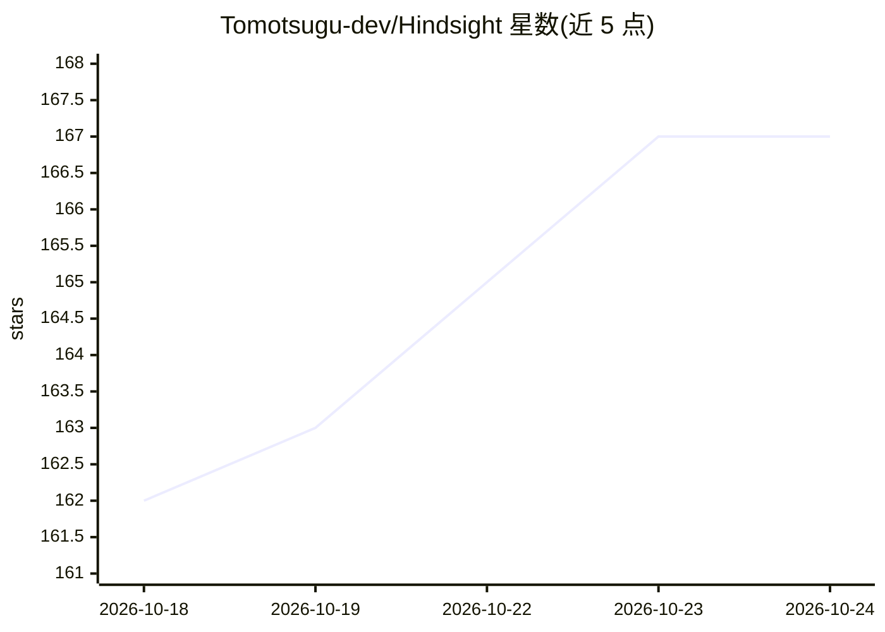

# Tomotsugu-dev/Hindsight

⭐ 167 · Rust · GPL-3.0 · 推送 2026-10-23 · [GitHub](https://github.com/Tomotsugu-dev/Hindsight) · [官网](https://hindsight.kyosweb.com/) · 个人维护 · 中文 README

**本地优先的桌面活动记录器：自动记录并用 AI 生成日报**

后台自动记录应用与窗口活动的桌面时间追踪工具，按日/周/月以图表统计活动分布，无需手动计时或项目标签。AI 功能包括本地或云端模型生成的每日活动报告、基于个人记录的问答式 AI 聊天；另提供屏幕文字记忆搜索（截图与 OCR 默认关闭，按需开启）。数据默认留在本机，可选通过 Google Drive 或 WebDAV 同步聚合多设备数据。Windows 与 macOS 提供安装包下载；Windows 安装包未做 EV 代码签名，首启会触发 SmartScreen 拦截。

## 筛选速览

| 维度 | 判定 | 备注 |
|---|---|---|
| AI 角色 | `ai-enhanced` | 去掉 AI 部分产品仍成立 |
| 许可风险 | `viral` | GPL-3.0 |
| 部署形态 | `desktop` | 安装包/桌面程序 |
| 模型依赖 | — | README 未给出锁定关系 |
| 硬件要求 | — | 无带数字的原话,不猜 |
| 安装摩擦 | `low` | 无编译、无系统依赖或容器化 |
| 成熟度 | — | 结构信号不足 |

## 能力要点

- 后台自动记录应用/窗口活动，日/周/月图表统计
- 本地或云端模型生成 AI 每日报告
- 基于个人活动记录的 AI 问答（如“本月 X 上花了多久”）
- 屏幕文字记忆搜索（OCR 默认关闭，按需开启）

## 适用场景

- 想知道每天时间都花在哪些应用上
- 让 AI 汇总生成一天的活动报告
- 多台电脑的用户同步聚合活动数据分析

## 场景标签

`数据分析` · 领域:效率与自动化

## 证据(README 行号)

> L5:  A local-first computer activity log & AI review tool
> L67: - 🤖 **AI daily report** — A local model summarizes your activities throughout the day into a daily report
> L69: - 🔍 **Screen memory search** — Find any text that ever appeared on your screen and jump to the screenshot and momen

## 星数曲线

2026-10-18 162 → 2026-10-24 167（+5）

---
*卡片 v1 · prompt 1.4 · 生成 2026-10-22 · 置信度 high · 依据 README sha `bb5cedba1f59` · [字段定义](../../DATASET.md)*
