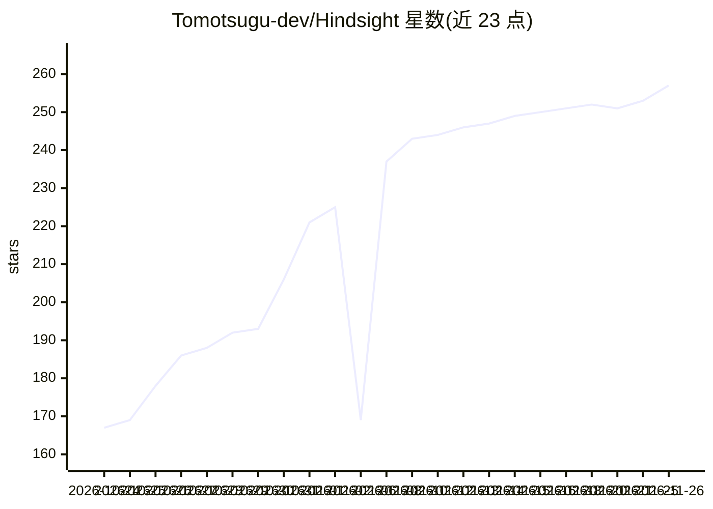

# Tomotsugu-dev/Hindsight

⭐ 257 · Rust · GPL-3.0 · 推送 2026-11-25 · [GitHub](https://github.com/Tomotsugu-dev/Hindsight) · [官网](https://hindsight.kyosweb.com/) · 个人维护 · 中文 README

**本地优先的桌面活动追踪器，附设备端 AI 日报与多设备同步**

一款跨平台桌面应用：后台自动记录电脑使用活动，以日/周/月统计图表与活动分类排名展示时间去向；可启用屏幕截图与 OCR，检索屏幕上出现过的文字并跳转到对应时刻。内置番茄钟。AI 部分包括用本地或云端模型生成每日书面报告、基于自身活动记录的问答聊天。数据默认留在本机，可选通过 Google Drive 或 WebDAV 在多设备间同步聚合，并支持插件市场与自定义主题。安装方式为各平台下载安装包；Arch Linux 需从源码用 makepkg 构建。

## 筛选速览

| 维度 | 判定 | 备注 |
|---|---|---|
| AI 角色 | `ai-enhanced` | 去掉 AI 部分产品仍成立 |
| 许可风险 | `viral` | GPL-3.0 |
| 部署形态 | `desktop` | 安装包/桌面程序 |
| 模型依赖 | — | README 未给出锁定关系 |
| 硬件要求 | — | 无带数字的原话,不猜 |
| 安装摩擦 | `low` | 无编译、无系统依赖或容器化 |
| 成熟度 | — | 结构信号不足 |

## 能力要点

- 后台自动记录活动，按日/周/月图表与分类统计展示
- 本地或云端模型生成 AI 日报，并支持基于记录的 AI 问答
- 屏幕文字检索：OCR 默认关闭，按需启用
- 通过 Google Drive 或 WebDAV 做多设备同步聚合

## 适用场景

- 查看自己每天/每周/每月的时间花在哪里
- 让 AI 汇总当天活动生成日报
- 搜索屏幕上曾出现过的文字定位截图时刻
- 在多台电脑之间聚合分析活动数据

## 场景标签

`OCR` · 领域:感知与多模态

## 证据(README 行号)

> L64: - **See where your time goes** — Automatically records computer activity in the background and visualizes it in a r
> L65: - **AI daily report** — A local model summarizes your activities throughout the day into a daily report

## 星数曲线

2026-10-24 167 → 2026-11-26 257（+90）

---
*卡片 v1 · prompt 1.4 · 生成 2026-11-26 · 置信度 high · 依据 README sha `6a7a5c109807` · [字段定义](../../DATASET.md)*
