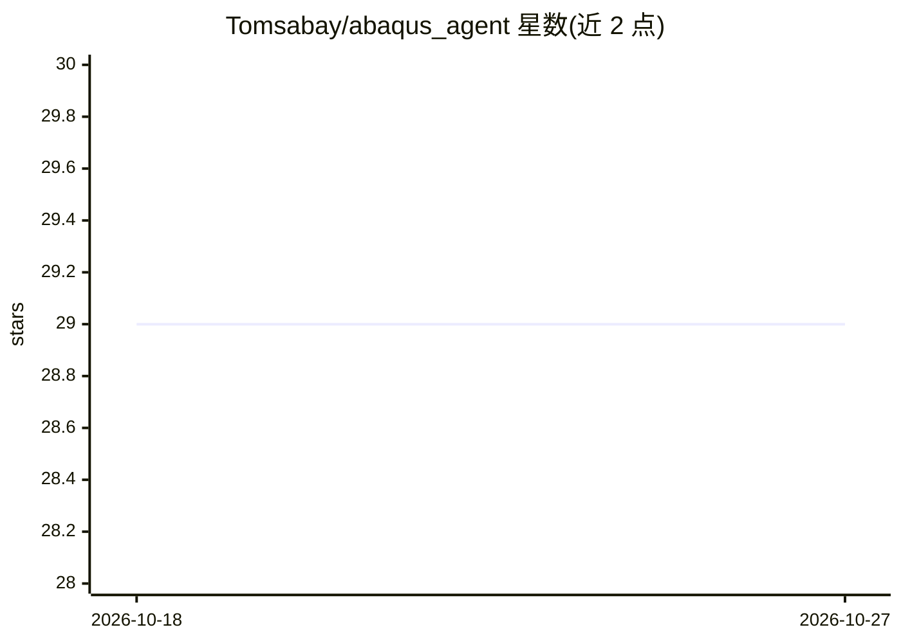

# Tomsabay/abaqus_agent

⭐ 29 · Python · AGPL-3.0 · 推送 2026-08-31 · [GitHub](https://github.com/Tomsabay/abaqus_agent) · 个人维护 · 中文 README

**Abaqus 仿真本地 QA 与回归框架：可复现实验胶囊与结果校验**

面向 Abaqus FEA 团队的本地仿真质量保障工具：将 .inp 或 spec 经语法检查、求解器运行、ODB KPI 提取、物理契约校验到 diff 报告组织成可复现的实验胶囊（capsule.json 含输入、哈希、环境与溯源）。核心为确定性、可审计的流程，LLM、MCP 客户端、Codex、Claude Code 或 Web UI 均为可选前端。提供 spec 方言经 getattr 通用派发调用 Abaqus API，并以 expect 块与 41 个 gate 校验；含 Solver Doctor 日志诊断（30+ 模式）、报告导出与案例记忆检索。限制：必须有 Abaqus 许可环境，无 Abaqus 时拒绝运行而非近似；CalculiX 备用后端已移除。

## 筛选速览

| 维度 | 判定 | 备注 |
|---|---|---|
| AI 角色 | `ai-enhanced` | 去掉 AI 部分产品仍成立 |
| 许可风险 | `dual` | AGPL-3.0 |
| 部署形态 | `library` | 以包/库形式分发 |
| 模型依赖 | — | README 未给出锁定关系 |
| 硬件要求 | — | 无带数字的原话,不猜 |
| 安装摩擦 | `low` | 无编译、无系统依赖或容器化 |
| 成熟度 | `idea` | |

## 能力要点

- spec→语法检查→求解→ODB KPI→物理契约→diff 报告的确定性管线，产出含溯源的实验胶囊
- 通用派发直接调用 Abaqus Part/ConstrainedSketch API，用 expect 块与 41 个 gate 做实测校验
- Solver Doctor 从 .msg/.sta/.log/.dat 诊断 30+ 已知求解失败模式
- MCP QA 工具、CLI、API、Web UI 多通道暴露胶囊/契约/diff/doctor 内核

## 适用场景

- 把 Abaqus 运行变成可复现、可对比基线的实验胶囊
- 在交付客户前用物理契约校验 ODB KPI 是否在合理范围
- 团队仿真结果回归：对比两次运行的输入、KPI 与产物的结构化差异
- 让 MCP 客户端或 LLM 前端在自己的 Abaqus 环境里执行经校验的仿真工作流

## 场景标签

`工作流自动化` · 领域:效率与自动化

## 证据(README 行号)

> L10: **Local Simulation QA & Regression Framework for Abaqus FEA.**
> L18: Abaqus Agent runs in your own Abaqus-licensed environment. The core is deterministic and auditable; LLMs, MCP clien

## 星数曲线

2026-10-18 29 → 2026-10-27 29（+0）

---
*卡片 v1 · prompt 1.4 · 生成 2026-10-26 · 置信度 high · 依据 README sha `9fadf43f3a3f` · [字段定义](../../DATASET.md)*
