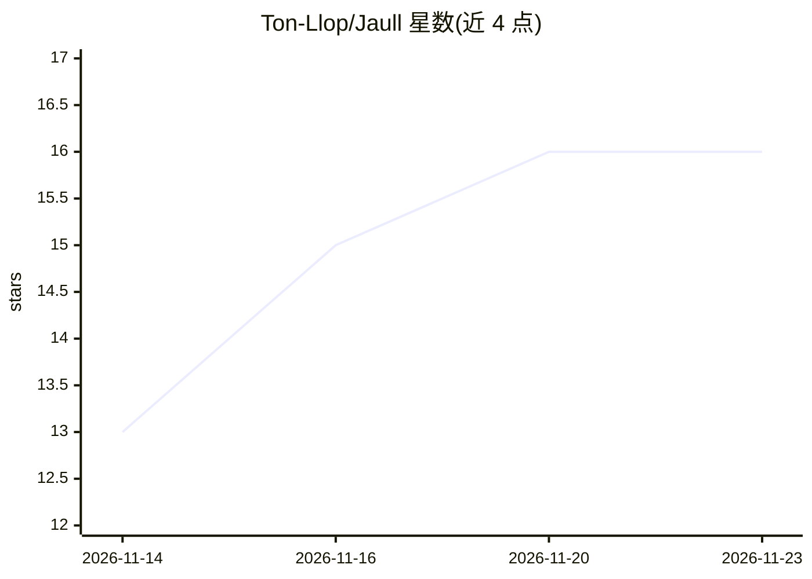

# Ton-Llop/Jaull

⭐ 16 · Python · MIT · 推送 2026-11-21 · [GitHub](https://github.com/Ton-Llop/Jaull) · [官网](jaull.tech) · 个人维护

**检测本机硬件并推荐、验证可运行本地 LLM 的工具**

面向想在本地跑大模型的用户：扫描 CPU/RAM/GPU 与计算后端（CUDA/Vulkan/CPU），通过几步自然语言问答给出最多五个可执行的模型方案（含具体文件、量化与理由），排名由显式规则生成而非语言模型。可下载并校验 GGUF 工件、安装 llama.cpp 官方构建、运行模型并实测速度与质量，实测结果可重排推荐；还能启动 llama-server 对外提供 OpenAI 兼容服务（进行中）。声明为本科学位论文项目，可用但未完成；质量评估需 Linux/WSL 与 Docker。

## 筛选速览

| 维度 | 判定 | 备注 |
|---|---|---|
| AI 角色 | `ai-ecosystem` | LLM/agent 周边工具 |
| 许可风险 | `permissive` | MIT |
| 部署形态 | `self-host` | docker 或自建部署 |
| 模型依赖 | local-ok | 支持本地模型 |
| 硬件要求 | — | 无带数字的原话,不猜 |
| 安装摩擦 | `low` | 无编译、无系统依赖或容器化 |
| 成熟度 | `idea` | |

## 能力要点

- 硬件扫描与可解释的内存估计（权重/KV cache/开销分项，各带 provenance）
- 基于执行计划的规则化推荐，实测结果可重排序，不依赖 LLM 生成排名或解释
- 一条命令安装校验过的 llama.cpp 构建（CUDA/Vulkan/CPU）
- GGUF 工件按 revision 下载并以 SHA-256 校验

## 适用场景

- 不确定自己电脑能跑什么模型时获取可执行的推荐方案
- 下载、验证并本地运行选定的 GGUF 模型
- 在本机或局域网启动 llama-server 对外提供 OpenAI 兼容 API
- 实测模型在自己机器上的速度与质量以验证推荐

## 场景标签

 · 领域:本地 AI 基础设施/模型选型

## 证据(README 行号)

> L153: Jaull is an explainable local-AI qualification toolkit. It reads your machine, selects
> L168: predict → acquire → verify → execute → benchmark → compare → qualify → deploy
> L32: - Install a verified build of llama.cpp with one command, for CUDA, Vulkan or the CPU.

## 星数曲线

2026-11-14 13 → 2026-11-23 16（+3）

---
*卡片 v1 · prompt 1.4 · 生成 2026-11-18 · 置信度 mid · 依据 README sha `adb3cbc821d4` · [字段定义](../../DATASET.md)*
