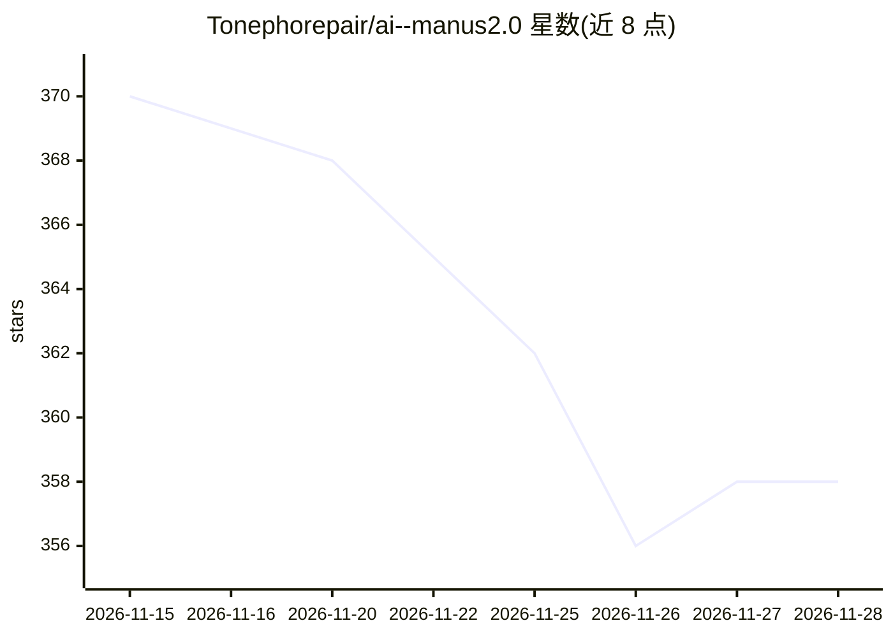

# Tonephorepair/ai--manus2.0

⭐ 358 · Apache-2.0 · 推送 2026-11-15 · [GitHub](https://github.com/Tonephorepair/ai--manus2.0) · 个人维护

**面向个人用户的自主 AI 代理：自主执行代码并控制浏览器**

Manus 是一个自主 AI 代理系统，代表用户编写并执行脚本、控制浏览器（导航网页、填表、采集信息），并可执行多步骤日常任务，面向家庭、学习与轻量办公场景，宣称无需编程背景。README 提供了系统兼容性表（最低双核 CPU / 4 GB RAM）与上手流程（配置、测试、逐步扩展任务），但未给出具体的安装命令、模型接入方式或代码仓库使用说明，功能描述以宣传性文字为主。

## 筛选速览

| 维度 | 判定 | 备注 |
|---|---|---|
| AI 角色 | `ai-native` | 本体是模型或模型工具 |
| 许可风险 | `permissive` | Apache-2.0 |
| 部署形态 | `None` |  |
| 模型依赖 | — | README 未给出锁定关系 |
| 硬件要求 | — | 无带数字的原话,不猜 |
| 安装摩擦 | `low` | 无编译、无系统依赖或容器化 |
| 成熟度 | — | 结构信号不足 |

## 能力要点

- 自主执行代码完成多步骤任务
- 浏览器控制：导航、填表、信息采集
- 面向家庭/学习/轻量办公的非开发者用户

## 适用场景

- 让代理代替我整理研究资料、跑小脚本
- 自动浏览多个网页汇总信息
- 处理日常重复性小任务

## 场景标签

`浏览器自动化` `AI 助手` · 领域:效率与自动化

## 证据(README 行号)

> L10: - **Autonomous Code Execution:** Manus AI agent runs code on its own to complete tasks, so you can focus on decisio
> L18: Manus is an autonomous AI agent designed to run code and control a browser on your behalf. Instead of acting like a

## 星数曲线

2026-11-15 370 → 2026-11-28 358（-12）

---
*卡片 v1 · prompt 1.4 · 生成 2026-11-17 · 置信度 low · 依据 README sha `71798a5b9c2b` · [字段定义](../../DATASET.md)*
