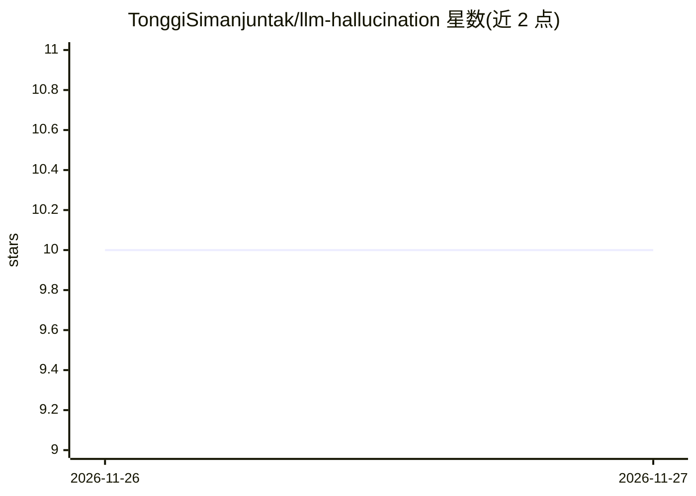

# TonggiSimanjuntak/llm-hallucination

⭐ 10 · Jupyter Notebook · 推送 2026-11-24 · [GitHub](https://github.com/TonggiSimanjuntak/llm-hallucination) · 组织维护

**印尼语公共服务问题 LLM 幻觉检测与 RAG 缓解研究项目**

课程研究项目，测量 Qwen3-4B-Instruct-2507 在印尼语人口行政与证件类公共服务问题上的幻觉率，构建基于回答一致性投票的幻觉检测器，并评估 RAG 作为缓解手段；对照集为 TruthfulQA 随机 300 题。仓库包含原始文档、QA 数据集、Colab notebook 与文档，运行说明尚未完成，截至 Progress 3 仅提供环境准备与模型加载步骤。

## 筛选速览

| 维度 | 判定 | 备注 |
|---|---|---|
| AI 角色 | `ai-knowledge` | 知识聚合/清单类 |
| 许可风险 | `none` | — |
| 部署形态 | `None` |  |
| 模型依赖 | — | README 未给出锁定关系 |
| 硬件要求 | — | 无带数字的原话,不猜 |
| 安装摩擦 | `low` | 无编译、无系统依赖或容器化 |
| 成熟度 | `idea` | |

## 能力要点

- 四组实验场景：无 RAG 基线、RAG 缓解、一致性检测器、TruthfulQA 迁移测试
- 基于回答一致性的幻觉检测器（Benar/Halusinasi/Tidak menjawab 三标签）
- 数据来源 URL 与访问日期记录，答案真值锚定到当日文档副本
- Colab GPU (T4) notebook 运行，模型以 float16 加载

## 适用场景

- 研究印尼语公共服务领域 LLM 幻觉表现
- 复用其一致性投票幻觉检测方法做评估实验
- 作为课程/科研团队幻觉检测项目的工程模板

## 场景标签

`RAG` `科研工具` · 领域:知识与检索

## 证据(README 行号)

> L11: Project ini mengukur tingkat halusinasi Qwen3-4B-Instruct-2507 pada pertanyaan layanan publik administrasi kependud
> L26: |S3|Detektor halusinasi berbasis konsistensi jawaban|
> L69: |1|Tonggi Simanjuntak|42324006|Ketua koordinasi & Integrasi|

## 星数曲线

2026-11-26 10 → 2026-11-27 10（+0）

---
*卡片 v1 · prompt 1.4 · 生成 2026-11-26 · 置信度 high · 依据 README sha `aaee18f90f53` · [字段定义](../../DATASET.md)*
