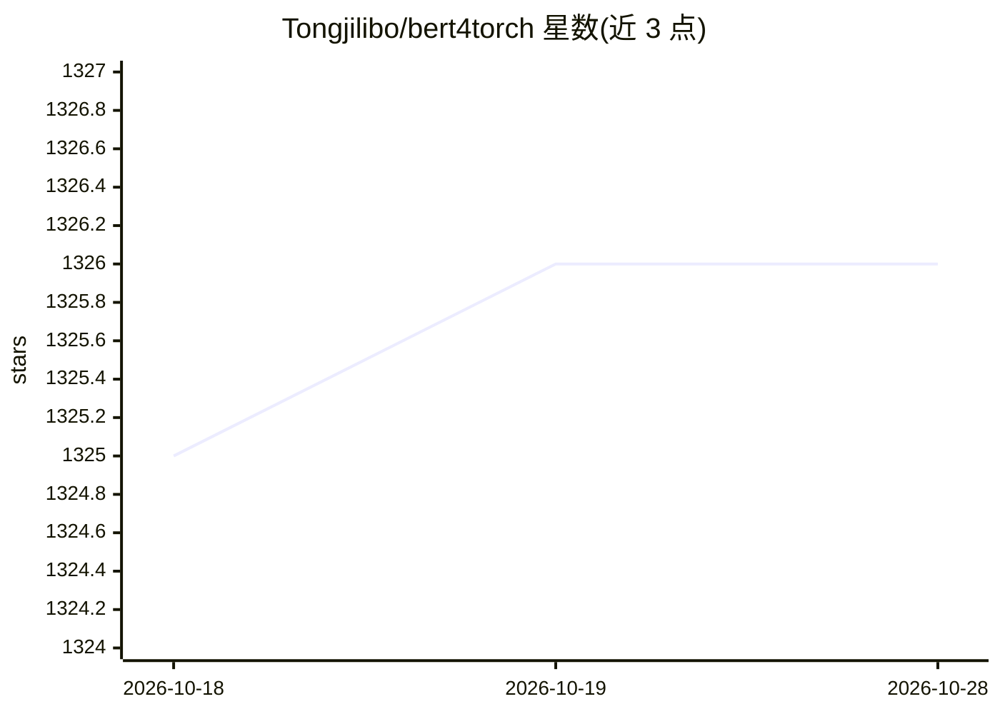

# Tongjilibo/bert4torch

⭐ 1,326 · Python · MIT · 推送 2026-05-16 · [GitHub](https://github.com/Tongjilibo/bert4torch) · [官网](https://bert4torch.readthedocs.io/) · 个人维护 · 中文 README

**PyTorch 版 transformers 训练框架：加载预训练权重微调与部署 LLM**

用 PyTorch 和 keras 风格 API 重新实现 transformers 系模型：支持加载 bert、roberta、albert、nezha、T5、GPT 等预训练权重继续 finetune，也支持加载 chatglm、llama、baichuan、Qwen、DeepSeek 等开源大模型权重进行推理和微调（含 lora、gptq/awq 量化），提供 bert4torch serve 命令行一行部署大模型（CLI/gradio/openai_api 方式）。面向 NLP 开发者，内置句子分类、序列标注、关系抽取、句向量等示例。开发环境为 torch2.0，个人维护。

## 筛选速览

| 维度 | 判定 | 备注 |
|---|---|---|
| AI 角色 | `ai-ecosystem` | LLM/agent 周边工具 |
| 许可风险 | `permissive` | MIT |
| 部署形态 | `library` | 以包/库形式分发 |
| 模型依赖 | — | README 未给出锁定关系 |
| 硬件要求 | — | 无带数字的原话,不猜 |
| 安装摩擦 | `low` | 无编译、无系统依赖或容器化 |
| 成熟度 | — | 结构信号不足 |

## 能力要点

- bert/roberta/T5/GPT 等预训练权重继续 finetune，支持灵活自定义模型
- 加载 chatglm/llama/Qwen/DeepSeek 等开源 LLM 权重推理与微调（lora、gptq/awq）
- bert4torch serve 命令行一行部署大模型（CLI/gradio/openai_api）
- 集成常见 trick 即插即用，keras 风格训练代码

## 适用场景

- 在自己的数据上微调 BERT 类或 LLM 模型做分类、标注、抽取
- 命令行快速本地部署开源大模型服务
- 对照示例学习各类 NLP 任务的训练流程

## 场景标签

`微调` `模型量化` `推理引擎` · 领域:训练与推理

## 证据(README 行号)

> L41: - **LLM模型**: 加载chatglm、llama、 baichuan、ziya、bloom等开源大模型权重进行推理和微调，命令行一行部署大模型
> L42: - **核心功能**：加载bert、roberta、albert、xlnet、nezha、bart、RoFormer、RoFormer_V2、ELECTRA、GPT、GPT2、T5、GAU-alpha、ERNIE等预训练权重继续进
> L46: - **其他特性**：加载transformers库模型一起使用；调用方式简洁高效；有训练进度条动态展示；配合torchinfo打印参数量；默认Logger和Tensorboard简便记录训练过程；自定义fit过程，满足高阶需求

## 星数曲线

2026-10-18 1,325 → 2026-10-28 1,326（+1）

---
*卡片 v1 · prompt 1.4 · 生成 2026-10-21 · 置信度 high · 依据 README sha `acb0ad2eb6b7` · [字段定义](../../DATASET.md)*
