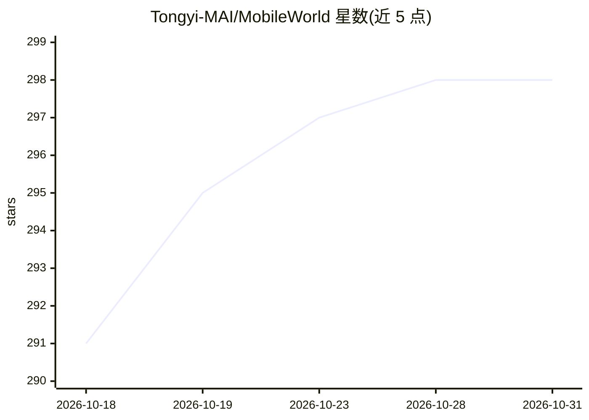

# Tongyi-MAI/MobileWorld

⭐ 298 · Python · Apache-2.0 · 推送 2026-10-23 · [GitHub](https://github.com/Tongyi-MAI/MobileWorld) · [官网](https://tongyi-mai.github.io/MobileWorld/) · 组织维护 · 中文 README

**评测自主移动 Agent 的基准：201 任务、20 应用、MCP 与人机交互**

面向自主移动 Agent（GUI Agent）的评测基准（ACL 2026 论文），包含 201 个任务、20 个移动应用，特色为长程跨应用任务、Agent-用户动态交互任务与 MCP（Model Context Protocol）增强任务。整个评测环境以 Docker-in-Docker 容器运行：内置 rooted Android 虚拟设备、自托管开源应用后端（Mattermost/Mastodon/Mall4Uni）与编排 API 服务，采用 AVD 快照保证任务初始状态一致。验证方式包括文本答案匹配、后端数据库查询、ADB 本地存储检查与应用回调。提供 `mw` CLI 与排行榜/轨迹查看器，支持社区提交结果；也可通过 ADB 驱动真实 Android 手机测试。要求 Linux 主机、Docker（privileged）、KVM 与 Python 3.12+，macOS 支持仍在进行中。

## 筛选速览

| 维度 | 判定 | 备注 |
|---|---|---|
| AI 角色 | `ai-ecosystem` | LLM/agent 周边工具 |
| 许可风险 | `permissive` | Apache-2.0 |
| 部署形态 | `None` |  |
| 模型依赖 | — | README 未给出锁定关系 |
| 硬件要求 | — | 无带数字的原话,不猜 |
| 安装摩擦 | `low` | 无编译、无系统依赖或容器化 |
| 成熟度 | — | 结构信号不足 |

## 能力要点

- 201 个任务覆盖 20 个移动应用，含长程跨应用任务
- Agent-用户交互任务与 MCP 增强任务（混合工具使用评测）
- Docker-in-Docker 容器化环境 + AVD 快照实现可复现评测
- 多种互补验证方式：文本匹配/数据库查询/ADB 存储检查/应用回调
- `mw` CLI 与网页轨迹查看器、排行榜及社区提交流程

## 适用场景

- 评测我的移动 GUI Agent 模型并提交排行榜结果
- 在人机交互与 MCP 工具混合场景下测试 Agent 能力
- 复现论文中对各家前沿模型的移动端任务评测
- 在真实 Android 手机上端到端测试模型作为移动 Agent 的表现

## 场景标签

`模型评测` · 领域:评测与运维

## 证据(README 行号)

> L22: While maintaining the same level of rigorous, reproducible evaluation as AndroidWorld, **MobileWorld** offers a mor
> L53: MobileWorld is a comprehensive benchmark for evaluating autonomous mobile agents in realistic scenarios. Our benchm

## 星数曲线

2026-10-18 291 → 2026-10-31 298（+7）

---
*卡片 v1 · prompt 1.4 · 生成 2026-10-22 · 置信度 high · 依据 README sha `7b5609cd1bd8` · [字段定义](../../DATASET.md)*
