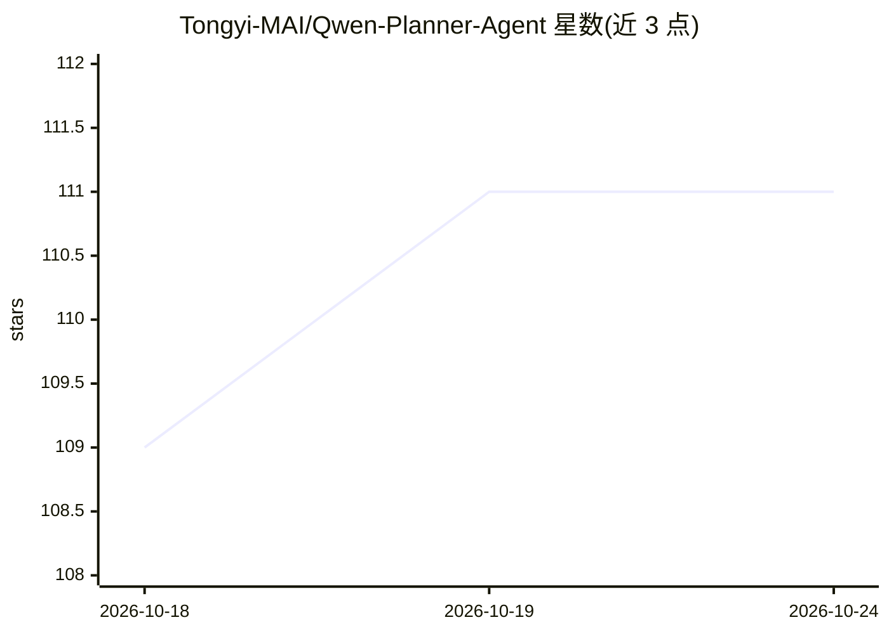

# Tongyi-MAI/Qwen-Planner-Agent

⭐ 111 · HTML · 推送 2026-09-26 · [GitHub](https://github.com/Tongyi-MAI/Qwen-Planner-Agent) · [官网](https://tongyi-mai.github.io/Qwen-Planner-Agent/) · 组织维护 · 中文 README

**移动端规划智能体框架的博客与技术报告展示仓库**

阿里巴巴 MAI Team 等团队维护的 Qwen-Planner-Agent 项目博客与技术报告网站仓库，展示研究成果与录制的交互案例回放，明确声明不是模型权重、训练代码或智能体实现的发布仓库。内容描述其框架：训练的规划模型配合有状态 Harness，协调原生工具、持久记忆、可复用 Skills 与子智能体完成移动任务；提出 CARE 方法在任务完成与推理/工具使用效率间平衡。附 MobilePA-Bench 上九个模型的评测对比与六类交互示例回放。

## 筛选速览

| 维度 | 判定 | 备注 |
|---|---|---|
| AI 角色 | `ai-knowledge` | 知识聚合/清单类 |
| 许可风险 | `none` | — |
| 部署形态 | `None` |  |
| 模型依赖 | — | README 未给出锁定关系 |
| 硬件要求 | — | 无带数字的原话,不猜 |
| 安装摩擦 | `low` | 无编译、无系统依赖或容器化 |
| 成熟度 | — | 结构信号不足 |

## 能力要点

- 闭环 AI-for-AI 框架：执行证据连接任务构建、轨迹整理、规划器训练与 Harness 改进
- 规划模型 27B 在 MobilePA-Bench 达 77.05% Overall，估算每千任务输出成本 $2.41
- 六类录制的交互示例回放，保留完整工具调用参数与返回（含失败与修正）
- 仓库为博客/技术报告网站，不含模型权重与训练代码

## 适用场景

- 了解移动端规划智能体的闭环训练与 Harness 设计方法
- 查看 MobilePA-Bench 上各模型的工具使用、记忆与子智能体协调评测数据
- 通过回放案例研究规划智能体的记忆引导规划与错误恢复行为

## 场景标签

 · 领域:AI 研究/移动智能体

## 证据(README 行号)

> L17: > **This is the blog and technical report website repository for Qwen-Planner-Agent**, containing research presenta
> L23: **Qwen-Planner-Agent** combines a trained Planner Model with a stateful Harness to carry mobile tasks from user int
> L70: - **AI for Data:** an agentic data flywheel constructs executable tasks, collects interaction trajectories, and use

## 星数曲线

2026-10-18 109 → 2026-10-24 111（+2）

---
*卡片 v1 · prompt 1.4 · 生成 2026-10-23 · 置信度 high · 依据 README sha `8f87d63c559c` · [字段定义](../../DATASET.md)*
