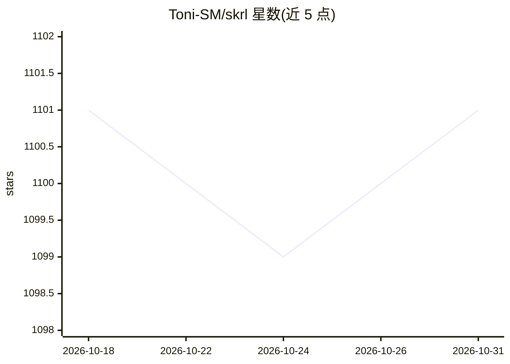

# Toni-SM/skrl

⭐ 1,101 · Python · MIT · 推送 2026-10-30 · [GitHub](https://github.com/Toni-SM/skrl) · [官网](https://skrl.readthedocs.io/) · 组织维护

**模块化强化学习库，支持多种机器人仿真环境训练**

skrl 是用 Python 编写的开源模块化强化学习库，算法实现覆盖 PyTorch、JAX 和 NVIDIA Warp 三种框架。支持 OpenAI Gym、Gymnasium、PettingZoo、ManiSkill 等环境接口，并可加载配置 NVIDIA Isaac Lab 与 MuJoCo Playground 环境，实现按环境子集（scopes）在同一运行中并行训练多个 agent。项目处于持续开发状态，作者建议保持最新版本；发布于 PyPI 并提供 readthedocs 文档。

## 筛选速览

| 维度 | 判定 | 备注 |
|---|---|---|
| AI 角色 | `ai-native` | 本体是模型或模型工具 |
| 许可风险 | `permissive` | MIT |
| 部署形态 | `library` | 以包/库形式分发 |
| 模型依赖 | — | README 未给出锁定关系 |
| 硬件要求 | — | 无带数字的原话,不猜 |
| 安装摩擦 | `low` | 无编译、无系统依赖或容器化 |
| 成熟度 | — | 结构信号不足 |

## 能力要点

- PyTorch / JAX / NVIDIA Warp 三种实现框架
- 支持 Gymnasium、PettingZoo、ManiSkill 等环境接口
- 可加载 NVIDIA Isaac Lab 与 MuJoCo Playground 环境
- 按 scopes 划分环境子集，同一运行内并行训练多个 agent

## 适用场景

- 在 Isaac Lab 或 MuJoCo Playground 中训练机器人控制策略
- 开展多 agent / 多环境子集的并行强化学习训练
- 阅读与修改算法实现开展强化学习研究

## 场景标签

`强化学习` · 领域:训练与推理

## 证据(README 行号)

> L21: **Description**: ``skrl`` is an open-source modular library for Reinforcement Learning written in Python
> L22: (implemented in PyTorch, JAX and NVIDIA Warp)

## 星数曲线

2026-10-18 1,101 → 2026-10-31 1,101（+0）

---
*卡片 v1 · prompt 1.4 · 生成 2026-10-21 · 置信度 high · 依据 README sha `07181ec775c0` · [字段定义](../../DATASET.md)*
