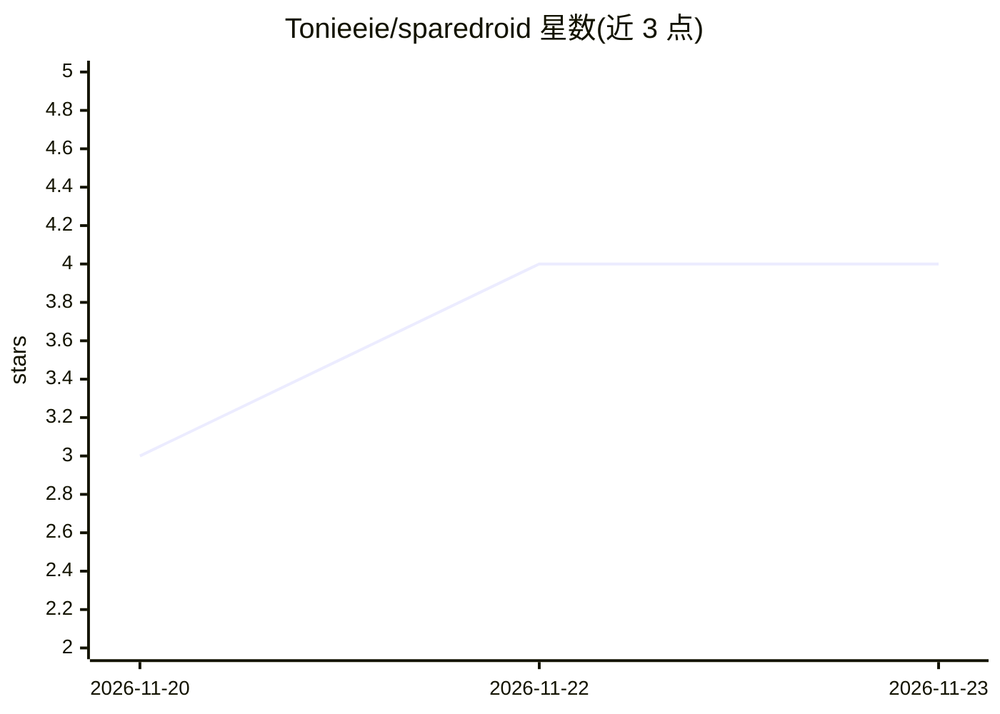

# Tonieeie/sparedroid

⭐ 4 · Python · MIT · 推送 2026-11-17 · [GitHub](https://github.com/Tonieeie/sparedroid) · 个人维护 · 中文 README

**把闲置安卓手机变成无接口应用的自动化 API，做群聊机器人**

通过安卓通知监听与无障碍服务，让一台专用手机对指定应用执行听通知、读屏幕、点击输入三类动作，服务端用 Python handler 决定响应逻辑，不需 root、不修改目标应用。首个打磨用例是企业微信外部群的 AI 客服与接单机器人；同时提供 MCP 服务与 Claude Code Skill/插件形态，让 AI 助手直接操作手机。限制：iOS 不支持，鸿蒙未适配，锁屏须设为「无」，部分新功能尚未真机验证，自动化账号存在被目标应用限制的风险。

## 筛选速览

| 维度 | 判定 | 备注 |
|---|---|---|
| AI 角色 | `ai-enhanced` | 去掉 AI 部分产品仍成立 |
| 许可风险 | `permissive` | MIT |
| 部署形态 | `self-host` | docker 或自建部署 |
| 模型依赖 | locked-api |  |
| 硬件要求 | — | 无带数字的原话,不猜 |
| 安装摩擦 | `low` | 无编译、无系统依赖或容器化 |
| 成熟度 | `idea` | |

## 能力要点

- 通知监听+无障碍读屏/操作，应用白名单控制边界
- Python handler 编写响应逻辑，含 bot.run 通用动作集
- 自带 MCP 服务，Claude Code/Desktop/Cursor 可直接操作手机
- 功能可双端独立开关，支持截图、快捷回复、电量告警

## 适用场景

- 企业微信外部群自动客服与接单录入
- 把没有接口的店铺/工单应用消息转发到团队群
- 定时读屏抄录订单数、库存等数据进表格
- 给 AI Agent 接一部能看屏、能点按的安卓手机

## 场景标签

`聊天机器人` `GUI 自动化` · 领域:效率与自动化

## 证据(README 行号)

> L6: SpareDroid 让一台闲置安卓手机替你盯着这些应用：**听它的通知、读它的屏幕、替你点和输入**，
> L9: 第一个、也是打磨得最完整的用例：**企业微信外部群里的 AI 客服 / 接单机器人**。
> L227: ```bash
> L339: 改一个 JSON 文件就能用，零成本、回答完全可控。

## 星数曲线



2026-11-20 3 → 2026-11-23 4（+1）


---
*卡片 v1 · prompt 1.4 · 生成 2026-11-22 · 置信度 high · 依据 README sha `fcf4df64eef3` · [字段定义](../../DATASET.md)*
