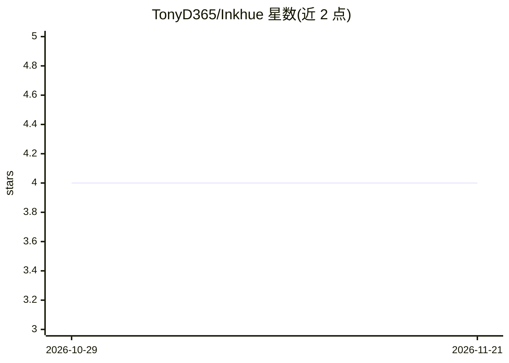

# TonyD365/Inkhue

⭐ 4 · Python · Apache-2.0 · 推送 2026-10-27 · [GitHub](https://github.com/TonyD365/Inkhue) · [官网](https://tonyd365.github.io/Inkhue/) · 个人维护 · 中文 README

**黑白打印纸内嵌颜色信息，扫描后还原彩色照片**

桌面应用（macOS/Windows/Linux），把彩色照片或文档编码为普通灰阶半调网点打印；每个 4×4 像素点阵单元中墨体质心的偏斜方向携带 2 比特颜色数据，经 Reed-Solomon 纠错与多次冗余编码遍布整页。扫描端支持 600 dpi（最低 400），自动检测边框、校正倾斜，并用约 1M 参数的 U-Net（ONNX Runtime，CPU 运行）去网点颗粒、输出 2× 分辨率图像。格式公开无加密，扫描需平板扫描仪，300 dpi 或手机拍照暂不支持。

## 筛选速览

| 维度 | 判定 | 备注 |
|---|---|---|
| AI 角色 | `ai-enhanced` | 去掉 AI 部分产品仍成立 |
| 许可风险 | `permissive` | Apache-2.0 |
| 部署形态 | `desktop` | 安装包/桌面程序 |
| 模型依赖 | — | README 未给出锁定关系 |
| 硬件要求 | — | 无带数字的原话,不猜 |
| 安装摩擦 | `low` | 无编译、无系统依赖或容器化 |
| 成熟度 | — | 结构信号不足 |

## 能力要点

- 每单元 2 比特内嵌颜色数据，约 45,000 比特/平方英寸
- Reed-Solomon 纠错加冗余副本，容忍笔迹、污渍、倾斜、倒置扫描
- 小型 U-Net 神经精修器（4 MB ONNX，CPU 约一秒）输出 2× 分辨率
- 支持 macOS ImageKit / Windows WIA / Linux SANE 应用内扫描

## 适用场景

- 用黑白打印机把彩色照片打印后扫描还原颜色
- 保留文档中的高亮、彩色文字与图表
- 黑白打印的同时保留可恢复的彩色信息

## 场景标签

`图像视频处理` · 领域:感知与多模态

## 证据(README 行号)

> L5: ### A black-and-white print that carries its own color.
> L62: - 🧠 **Neural refiner** (small U-Net, CPU via ONNX Runtime) — removes grain, sharpens color, outputs **2× resolution
> L189: **How it differs from QR codes and watermarks:** those store a few bytes to a few kilobytes, either next to the im

## 星数曲线

2026-10-29 4 → 2026-11-21 4（+0）

---
*卡片 v1 · prompt 1.4 · 生成 2026-11-21 · 置信度 high · 依据 README sha `40dea471b69a` · [字段定义](../../DATASET.md)*
