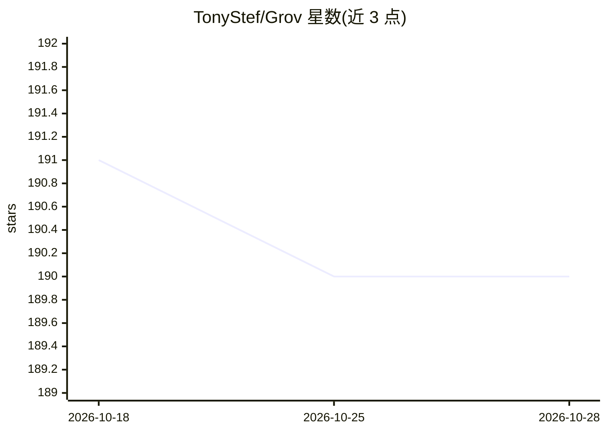

# TonyStef/Grov

⭐ 190 · TypeScript · Apache-2.0 · 推送 2026-01-29 · [GitHub](https://github.com/TonyStef/Grov) · [官网](https://grov.dev/) · 个人维护

**工程团队的共享 AI 记忆工具：捕获并同步 AI 会话上下文**

面向使用 AI 编码工具的开发团队的 CLI 工具：以代理或 MCP 方式接入 Claude Code、Cursor、Zed、Codex 等工具，在任务完成时自动抽取推理过程、关键决策、涉及文件与约束，存入本地 SQLite（~/.grov/memory.db），可选开启团队同步并在新会话中自动注入相关记忆。另提供漂移检测（四级纠正注入）、Anthropic prompt 缓存保活（opt-in）、上下文自动压缩、Web 仪表盘。个人及 3 人以下团队免费。

## 筛选速览

| 维度 | 判定 | 备注 |
|---|---|---|
| AI 角色 | `ai-ecosystem` | LLM/agent 周边工具 |
| 许可风险 | `permissive` | Apache-2.0 |
| 部署形态 | `library` | 以包/库形式分发 |
| 模型依赖 | locked-api |  |
| 硬件要求 | — | 无带数字的原话,不猜 |
| 安装摩擦 | `low` | 无编译、无系统依赖或容器化 |
| 成熟度 | — | 结构信号不足 |

## 能力要点

- 任务完成时自动抽取推理轨迹/决策/文件/约束并存入本地 SQLite
- 团队同步与跨开发者记忆注入，混合语义+关键词检索
- 漂移检测：用 Claude Haiku 对行为对齐打分并四级纠正注入
- 上下文窗口达 85% 时自动压缩并保留目标与关键决策

## 适用场景

- 团队多名开发者共享 AI 探索成果，避免重复调查与重复 token 消耗
- 在新 AI 会话中自动注入相关历史上下文
- 监控 AI 编码代理的行为是否偏离意图并及时纠正

## 场景标签

`Agent 记忆` · 领域:Agent 开发

## 证据(README 行号)

> L5:  Collective AI memory for engineering teams.
> L33: Grov captures what your team's AI learns and shares it automatically.
> L105: - **Automatic injection** - Relevant context injected into new sessions

## 星数曲线

2026-10-18 191 → 2026-10-28 190（-1）

---
*卡片 v1 · prompt 1.4 · 生成 2026-10-22 · 置信度 high · 依据 README sha `4159260d5ccf` · [字段定义](../../DATASET.md)*
