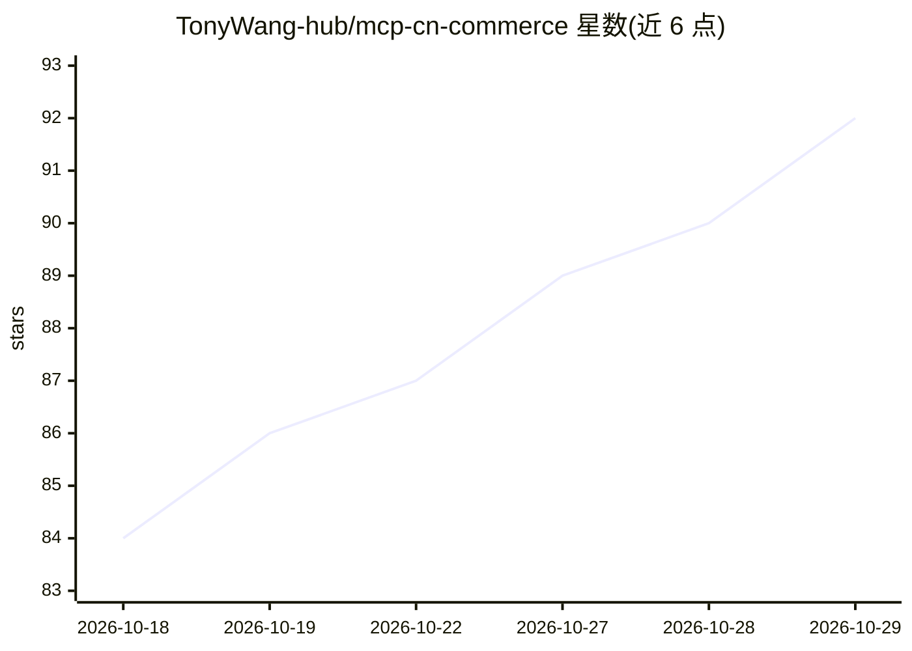

# TonyWang-hub/mcp-cn-commerce

⭐ 92 · Python · MIT · 推送 2026-10-26 · [GitHub](https://github.com/TonyWang-hub/mcp-cn-commerce) · [官网](https://github.com/TonyWang-hub/mcp-cn-commerce/releases) · 个人维护 · 中文 README

**让 AI Agent 只读访问中国电商平台商家经营数据的 MCP Server 套件**

覆盖抖店、淘宝、京东、拼多多、快手、小红书、微信小店、巨量引擎 8 个平台入口、155 个注册工具的 stdio MCP Server 套件（Monorepo），每个平台独立 server，按需安装。所有工具默认只读，聚焦订单、售后、店铺、广告主信息等商家经营数据，不做内容发布。Core 提供共享连接池、限流、指标、脱敏与确定性日报计算；工具描述携带 contract_status/supported/live_verified 字段。所有 SDK live_verified 均为 false，真实商家验收未完成；另有闭源 Pro 版独立交付。

## 筛选速览

| 维度 | 判定 | 备注 |
|---|---|---|
| AI 角色 | `ai-ecosystem` | LLM/agent 周边工具 |
| 许可风险 | `permissive` | MIT |
| 部署形态 | `library` | 以包/库形式分发 |
| 模型依赖 | — | README 未给出锁定关系 |
| 硬件要求 | — | 无带数字的原话,不猜 |
| 安装摩擦 | `low` | 无编译、无系统依赖或容器化 |
| 成熟度 | `idea` | |

## 能力要点

- 8 个平台 MCP 入口、155 个注册工具，每平台独立 stdio server
- 全部平台工具默认只读，零写入/修改/删除
- 工具描述携带 contract_status/supported/live_verified 逐操作合同状态
- 每 server 附 5 个公共工具：指标、链路追踪、告警、CSV/JSON 导出、日报生成

## 适用场景

- 让 Claude Desktop 等支持 MCP 的 AI Agent 查询我在各电商平台的订单与售后
- 跨平台汇总经营数据生成确定性日报，标注缺失字段与覆盖限制
- 客服通过 AI Agent 分析退款原因与差评预警

## 场景标签

`数据分析` · 领域:效率与自动化

## 证据(README 行号)

> L26: 一个 **MCP (Model Context Protocol) Server 套件**（Monorepo），让 AI Agent 能够结构化地访问中国电商平台的商家经营数据。每个平台是一个独立的 MCP Server，按需安装
> L116: 本项目是标准 stdio MCP server，所有支持 MCP 协议的客户端都能直接接入。下面给出主流客户端的配置方式（凭证可在 shell 里 `export`，也可写进客户端配置的 `env` 段，两种都行）。
> L250: - 👁️ **默认只读** — 全部平台工具只读数据，零写入/修改/删除操作

## 星数曲线

2026-10-18 84 → 2026-10-29 92（+8）

---
*卡片 v1 · prompt 1.4 · 生成 2026-10-23 · 置信度 high · 依据 README sha `4913aff2137d` · [字段定义](../../DATASET.md)*
