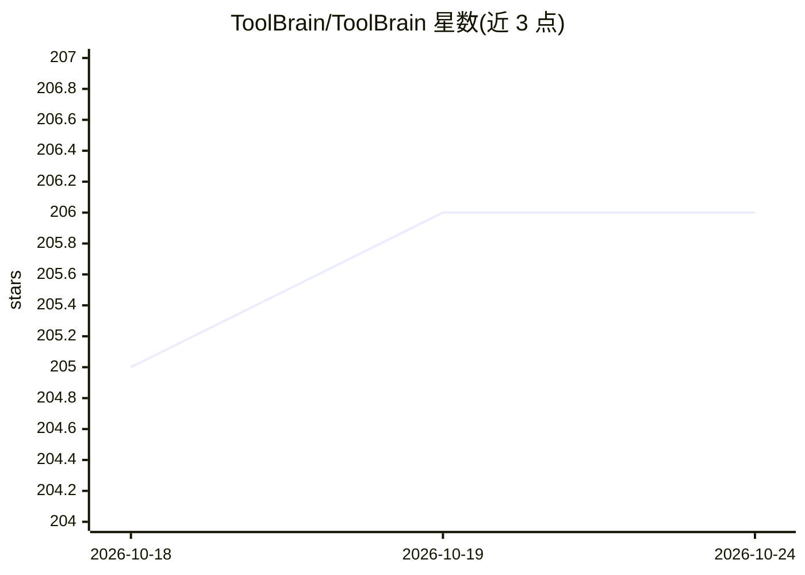

# ToolBrain/ToolBrain

⭐ 206 · Python · 推送 2026-04-08 · [GitHub](https://github.com/ToolBrain/ToolBrain) · [官网](https://toolbrain.org/) · 组织维护

**训练 agent 工具使用能力的强化学习框架（GRPO/DPO）**

轻量级开源 Python 库，面向 agentic 系统的工具使用训练：提供 GRPO、DPO 与监督学习算法，支持自定义奖励函数或 LLM-as-judge，提供大规模工具集合的可扩展检索、知识蒸馏与训练任务自动生成（Zero-learn）。通过适配器架构接入 SmolAgents 与 LangChain 等 agent 框架，支持 FP16/LoRA/Unsloth/BitsAndBytes 资源高效训练。需 Python 3.10+，附 arXiv 论文与 AAMAS 2026，配示例脚本。

## 筛选速览

| 维度 | 判定 | 备注 |
|---|---|---|
| AI 角色 | `ai-ecosystem` | LLM/agent 周边工具 |
| 许可风险 | `none` | — |
| 部署形态 | `library` | 以包/库形式分发 |
| 模型依赖 | — | README 未给出锁定关系 |
| 硬件要求 | — | 无带数字的原话,不猜 |
| 安装摩擦 | `low` | 无编译、无系统依赖或容器化 |
| 成熟度 | — | 结构信号不足 |

## 能力要点

- GRPO/DPO/监督学习三种训练算法
- 自定义奖励函数或 LLM-as-judge
- 工具集合可扩展检索与知识蒸馏
- 适配器架构接入 SmolAgents 与 LangChain

## 适用场景

- 为小参数模型做工具调用的强化学习微调
- 把自建 LangChain/SmolAgents agent 变得更会调用工具
- 用大模型蒸馏出高效的小型工具使用模型

## 场景标签

`强化学习` `微调` · 领域:训练与推理

## 证据(README 行号)

> L21: ToolBrain is a lightweight open-source Python library for training **agentic systems** with effective tool usage an
> L34: - 🧠 **Multiple agent frameworks**: Supports SmolAgent and LangChain, with more coming soon.

## 星数曲线

2026-10-18 205 → 2026-10-24 206（+1）

---
*卡片 v1 · prompt 1.4 · 生成 2026-10-22 · 置信度 high · 依据 README sha `81ffabb5ec31` · [字段定义](../../DATASET.md)*
