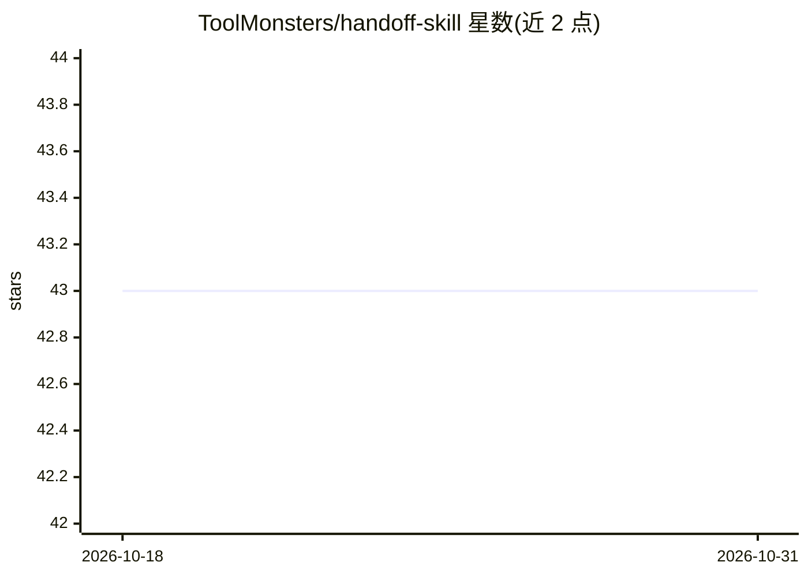

# ToolMonsters/handoff-skill

⭐ 43 · MIT · 推送 2026-07-23 · [GitHub](https://github.com/ToolMonsters/handoff-skill) · 组织维护

**Claude 技能：把当前对话生成完整交接文档供任意 LLM 续接**

面向 Claude Code 与 claude.ai/桌面端的技能（SKILL.md）：通过 /handoff 命令或自然语言触发，把当前会话整理为一份 markdown 交接文档，包含目标、已定决策、当前状态、逐字的工作草稿/代码、已放弃的路径与下一步。强制零编造，仅收录对话中实际出现的内容；输出可粘贴到 ChatGPT、Gemini 等任意模型继续。安装方式为 git clone 到 skills 目录或上传 SKILL.md。

## 筛选速览

| 维度 | 判定 | 备注 |
|---|---|---|
| AI 角色 | `ai-ecosystem` | LLM/agent 周边工具 |
| 许可风险 | `permissive` | MIT |
| 部署形态 | `None` |  |
| 模型依赖 | locked-api |  |
| 硬件要求 | — | 无带数字的原话,不猜 |
| 安装摩擦 | `low` | 无编译、无系统依赖或容器化 |
| 成熟度 | — | 结构信号不足 |

## 能力要点

- 生成含 7 个固定章节的 markdown 交接文档
- Work in progress 部分逐字保留草稿/代码而非摘要
- 零编造规则：只写入对话中实际出现的事实
- 支持 /handoff 命令与自然语言触发

## 适用场景

- 接近上下文上限时把会话打包成文档换新会话继续
- 把任务从 Claude 转移到 ChatGPT/Gemini 等其他模型
- 沉淀对话中的决策与被否方案避免重复讨论

## 场景标签

`提示工程` · 领域:Agent 开发

## 证据(README 行号)

> L3: A Claude skill that generates a complete handoff document of your current conversation, so another LLM (ChatGPT, a f
> L23: ### Claude Code

## 星数曲线

2026-10-18 43 → 2026-10-31 43（+0）

---
*卡片 v1 · prompt 1.4 · 生成 2026-10-25 · 置信度 high · 依据 README sha `da5ba2257150` · [字段定义](../../DATASET.md)*
