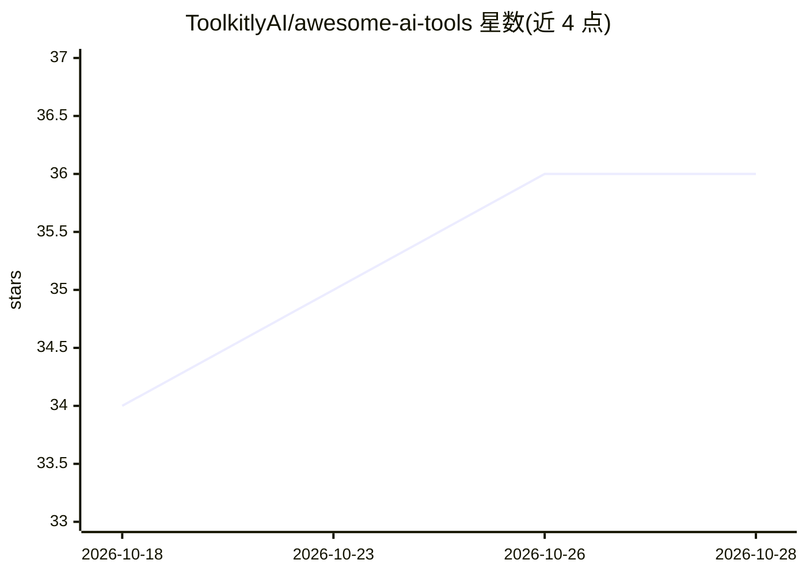

# ToolkitlyAI/awesome-ai-tools

⭐ 36 · MIT · 推送 2026-10-24 · [GitHub](https://github.com/ToolkitlyAI/awesome-ai-tools) · [官网](https://www.toolkitly.com) · 组织维护

**650+ AI 工具分类目录，按类别浏览与社区投稿**

由 Toolkitly.com 维护的 AI 工具策展清单：收录 650 余款面向生产力与创意场景的 AI 工具，按约 300 个类别组织（如 AI Agent、AI 图像生成、文本转语音、法律科技等）。用户通过 Toolkitly.com 提交收录申请，条目经审核后自动同步至本仓库，也可通过 pull request 参与。仓库本身为 MIT 许可的清单内容，不提供工具的安装或运行途径。

## 筛选速览

| 维度 | 判定 | 备注 |
|---|---|---|
| AI 角色 | `ai-knowledge` | 知识聚合/清单类 |
| 许可风险 | `permissive` | MIT |
| 部署形态 | `None` |  |
| 模型依赖 | — | README 未给出锁定关系 |
| 硬件要求 | — | 无带数字的原话,不猜 |
| 安装摩擦 | `low` | 无编译、无系统依赖或容器化 |
| 成熟度 | — | 结构信号不足 |

## 能力要点

- 收录 650+ 款 AI 工具
- 约 300 个类别组织条目，覆盖生产力、创意、开发、行业应用等
- 通过 Toolkitly.com 提交后自动同步至仓库，支持 pull request 投稿

## 适用场景

- 按类别查找适合自己工作流的 AI 工具
- 发现特定领域（如法律科技、语音克隆、矢量搜索）的 AI 产品
- 为自己的 AI 工具申请收录以获得曝光

## 场景标签

`精选清单` · 领域:学习与行业

## 证据(README 行号)

> L3: Welcome to a curated collection of 650+ AI-powered tools for productivity, creativity, and innovation.Brought to you
> L9: Explore our tool categories below:

## 星数曲线

2026-10-18 34 → 2026-10-28 36（+2）

---
*卡片 v1 · prompt 1.4 · 生成 2026-10-25 · 置信度 high · 依据 README sha `354ba6b2d0e5` · [字段定义](../../DATASET.md)*
