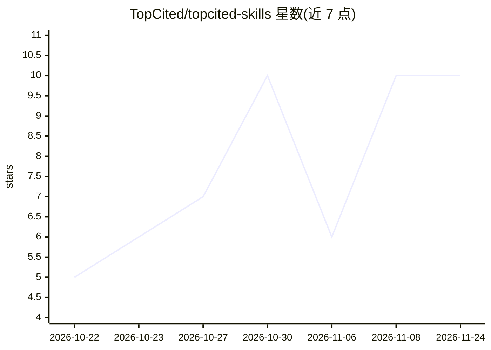

# TopCited/topcited-skills

⭐ 10 · Python · MIT · 推送 2026-11-21 · [GitHub](https://github.com/TopCited/topcited-skills) · 组织维护

**教 AI 代理做 SEO/GEO 的技能包：知识库、CLI 驱动与可见性工作流**

面向可读 Markdown 的 AI 编码代理（Claude Code、Codex 等）的 Agent Skills 集合，含三个技能：`seo-geo` 提供带引证与技术日期的 SEO/GEO 知识库；`topcited-api` 教代理通过 `topcited` CLI 驱动 TopCited 服务（含命令速查、JSON/exit code 代理契约、费用与失败说明）；`visibility-workflow` 编排前两者形成八阶段可见性提升流程。安装方式有 Claude Code 插件、git clone 复制到 skills 目录、或直接取原始 URL；后两个技能需另行安装 `topcited` CLI 并登录，多数 API 操作消耗 T-coins 积分，技能写法上会在花费前运行 `--dry-run` 并征求确认。

## 筛选速览

| 维度 | 判定 | 备注 |
|---|---|---|
| AI 角色 | `ai-knowledge` | 知识聚合/清单类 |
| 许可风险 | `permissive` | MIT |
| 部署形态 | `None` |  |
| 模型依赖 | — | README 未给出锁定关系 |
| 硬件要求 | — | 无带数字的原话,不猜 |
| 安装摩擦 | `low` | 无编译、无系统依赖或容器化 |
| 成熟度 | — | 结构信号不足 |

## 能力要点

- 三个技能：SEO/GEO 知识库、topcited CLI 驱动指南、八阶段可见性工作流
- SKILL.md 为纯 Markdown + YAML frontmatter + 路由表，可被任意代理按 URL 读取
- 花费前自动检查用量并执行 --dry-run 征求确认
- 提供 Claude Code 插件/市场清单与手动克隆两种安装途径

## 适用场景

- 让 Claude Code 或 Codex 在做 SEO 判断前查阅带引证的知识库
- 通过代理调用 topcited CLI 管理品牌的生成引擎可见性
- 按八阶段流程测量并改进品牌在 ChatGPT/Claude/Gemini 中的被引用情况
- 把技能接入无人值守自动化前自建预算护栏

## 场景标签

 · 领域:SEO/营销自动化/agent 技能

## 证据(README 行号)

> L1: # TopCited Skills
> L3: Agent Skills that teach an AI coding agent — Claude Code, Codex, or anything else
> L14: |`seo-geo`|A cited, dated knowledge base: technical SEO, entity & authority, content strategy, GEO, measurement, di

## 星数曲线

2026-10-22 5 → 2026-11-24 10（+5）

---
*卡片 v1 · prompt 1.4 · 生成 2026-11-20 · 置信度 high · 依据 README sha `9f24d6baffde` · [字段定义](../../DATASET.md)*
