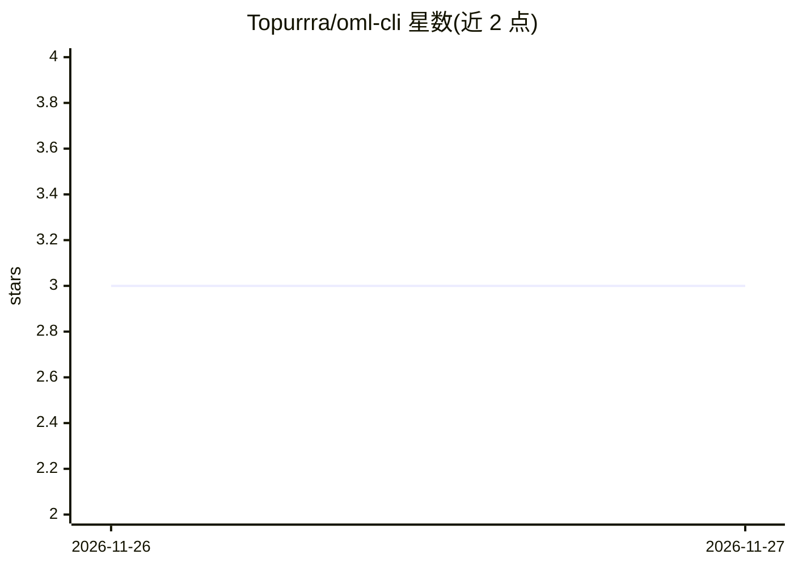

# Topurrra/oml-cli

⭐ 3 · C# · MIT · 推送 2026-11-24 · [GitHub](https://github.com/Topurrra/oml-cli) · [官网](https://topurrra.github.io/oml-cli/) · 个人维护

**供用户与 AI agent 安全读写 OutSystems 11 模块的 CLI**

通过本机已安装 Service Studio 的类型化 Model API 读取、修改、校验与评审 OutSystems 11 模块，并支持 Traditional Web 迁移到 Reactive；不直接编辑 OML XML。改动写入 staged 副本，强制生产规则，安装前校验并保留备份。提供约 3.3k token 的 agent skill，兼容 Claude Code、Cursor 等读取 AGENTS.md 的 agent。仅支持 Windows 与 Service Studio 11，不支持调试、SOAP 与 ODC。

## 筛选速览

| 维度 | 判定 | 备注 |
|---|---|---|
| AI 角色 | `ai-ecosystem` | LLM/agent 周边工具 |
| 许可风险 | `permissive` | MIT |
| 部署形态 | `desktop` | 安装包/桌面程序 |
| 模型依赖 | — | README 未给出锁定关系 |
| 硬件要求 | — | 无带数字的原话,不猜 |
| 安装摩擦 | `medium` | 含编译或系统依赖之一 |
| 成熟度 | — | 结构信号不足 |

## 能力要点

- 基于 Service Studio Model API 的读取/修改/校验/评审命令集，覆盖实体、界面、测试、迁移、LifeTime 部署等区域
- staged 副本工作流：改动需人工确认，安装仅在零校验错误时执行并保留备份
- 提供 agent skill 与 hooks，多 agent 并行编辑后一条命令合并
- 提供浏览器打开界面并报告各宽度下用户所见内容的命令

## 适用场景

- 让 AI agent 按 spec 批量修改 OutSystems 模块并自动校验
- 对模块做规则检查与两版本差异评审
- 将 Traditional Web 模块规划并迁移到 Reactive

## 场景标签

`编码 Agent` · 领域:编码与开发

## 证据(README 行号)

> L3: **OutSystems 11 from the command line, built for AI agents.**
> L5: `oml` reads, changes, checks and reviews OutSystems 11 modules through the typed Model API of your installed Service
> L76: Put the `skill/` folder in your project (`oml create` does it). It works with Claude Code, GitHub Copilot, Cursor, 

## 星数曲线

2026-11-26 3 → 2026-11-27 3（+0）

---
*卡片 v1 · prompt 1.4 · 生成 2026-11-26 · 置信度 high · 依据 README sha `af61d6e63187` · [字段定义](../../DATASET.md)*
