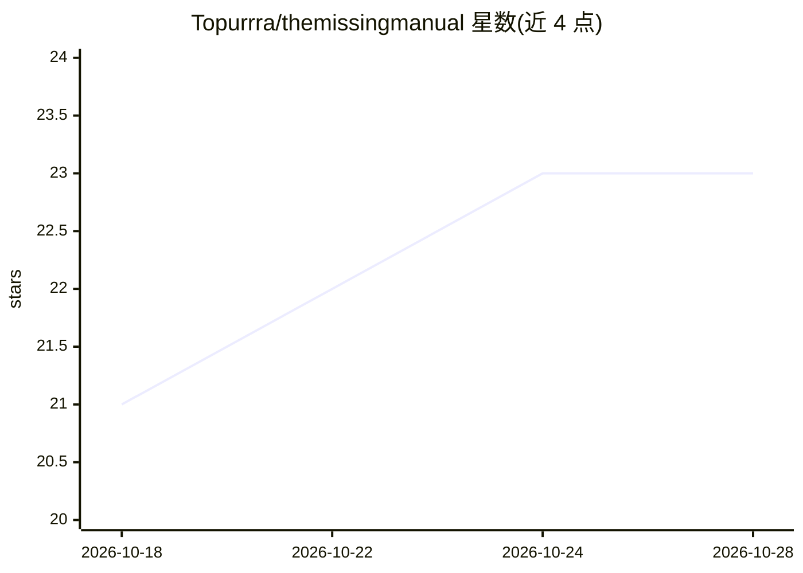

# Topurrra/themissingmanual

⭐ 23 · HTML · NOASSERTION · 推送 2026-10-06 · [GitHub](https://github.com/Topurrra/themissingmanual) · [官网](https://themissingmanual.dev) · 个人维护

**免费文本优先的开发者与 STEM 知识库（367 篇指南）**

文本优先的学习图书馆：367 篇指南、1,575 个阶段、27 个类别，覆盖 Git、操作系统、网络、安全、DevOps、7 门编程语言与 30+ 框架，以及逻辑、数学、物理。内容按 A→Z 分层组织，配交互式练习场、测验、可运行代码块与动画演示。提供基于指南自身内容的 AI 导师、间隔重复复习、离线 PWA 与 EPUB 导出。技术栈为 Rust（axum + Tantivy 全文搜索）+ SvelteKit，指南为带 YAML frontmatter 的 Markdown，并暴露 MCP server 供 AI agent 检索阅读。免费、无账号、无广告。

## 筛选速览

| 维度 | 判定 | 备注 |
|---|---|---|
| AI 角色 | `ai-knowledge` | 知识聚合/清单类 |
| 许可风险 | `none` | NOASSERTION |
| 部署形态 | `None` |  |
| 模型依赖 | — | README 未给出锁定关系 |
| 硬件要求 | — | 无带数字的原话,不猜 |
| 安装摩擦 | `low` | 无编译、无系统依赖或容器化 |
| 成熟度 | — | 结构信号不足 |

## 能力要点

- 367 篇指南 / 27 类别，覆盖编程、DevOps 与数理基础
- AI 导师基于指南自身内容回答并引用出处
- Tantivy 全文搜索 + MCP server，机器可读（JSON-LD、raw Markdown）
- 离线 PWA、EPUB 导出、间隔重复复习

## 适用场景

- 从零基础到进阶系统学习某项开发技术
- 通过练习、测验和间隔重复巩固已学内容
- 让 AI agent 通过 MCP 直接检索和阅读该知识库

## 场景标签

`教程课程` · 领域:学习与行业

## 证据(README 行号)

> L11: - **367 guides, 1,575 phases, 27 categories** - Git, operating systems, hardware, networking,
> L21: - **An AI tutor** that answers questions about the exact phase you're reading, grounded in and

## 星数曲线

2026-10-18 21 → 2026-10-28 23（+2）

---
*卡片 v1 · prompt 1.4 · 生成 2026-10-27 · 置信度 high · 依据 README sha `954e75bb2758` · [字段定义](../../DATASET.md)*
