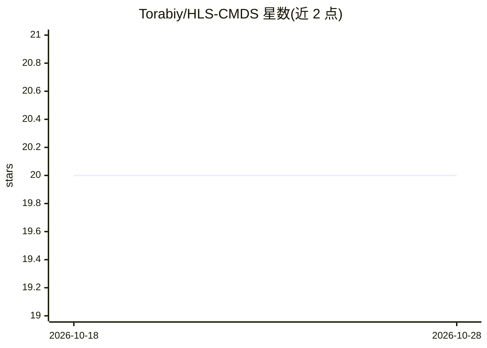

# Torabiy/HLS-CMDS

⭐ 20 · Jupyter Notebook · MIT · 推送 2026-05-13 · [GitHub](https://github.com/Torabiy/HLS-CMDS) · [官网](https://doi.org/10.1109/IEEEDATA.2025.3566012) · 组织维护

**数字听诊器录制的心肺音数据集（HLS-CMDS）**

在临床模拟人上用数字听诊器采集的心音与肺音数据集：Version 2 含 535 条 .wav 录音（50 心音、50 肺音、145 混合音及各 145 条对应源音），覆盖 12 个胸壁听诊部位与 16 种正常/异常音类型（杂音、房颤、哮鸣、湿啰音等），每条录音经过滤波以突出特定声音类型。配套 Python 脚本提供时域波形绘制、Mel 频谱图与人口学分布可视化（依赖 librosa/matplotlib/numpy）。数据集发表于 IEEE Data Descriptions。

## 筛选速览

| 维度 | 判定 | 备注 |
|---|---|---|
| AI 角色 | `ai-knowledge` | 知识聚合/清单类 |
| 许可风险 | `permissive` | MIT |
| 部署形态 | `None` |  |
| 模型依赖 | — | README 未给出锁定关系 |
| 硬件要求 | — | 无带数字的原话,不猜 |
| 安装摩擦 | `low` | 无编译、无系统依赖或容器化 |
| 成熟度 | — | 结构信号不足 |

## 能力要点

- 535 条来自临床模拟人的心/肺/混合音 .wav 录音（V2）
- 16 种正常与异常音类型、12 个听诊部位标注
- 混合音均附对应源心音/源肺音录音
- 配套可视化脚本：时域波形、Mel 频谱、分布环形图

## 适用场景

- 训练心肺疾病自动检测或音频分类模型
- 做无监督心音/肺音分离研究的成对数据
- 分析不同听诊部位的声音分布特征

## 场景标签

 · 领域:医学/音频数据集

## 证据(README 行号)

> L10: This dataset contains 535 recordings of heart and lung sounds captured using a digital stethoscope from a clinical 
> L15: - **Applications:** AI-based cardiopulmonary disease detection, unsupervised sound separation techniques, deep lear
> L2: # Heart and Lung Sounds Dataset Recorded from a Clinical Manikin using Digital Stethoscope (HLS-CMDS)

## 星数曲线

2026-10-18 20 → 2026-10-28 20（+0）

---
*卡片 v1 · prompt 1.4 · 生成 2026-10-28 · 置信度 high · 依据 README sha `c204536ea704` · [字段定义](../../DATASET.md)*
