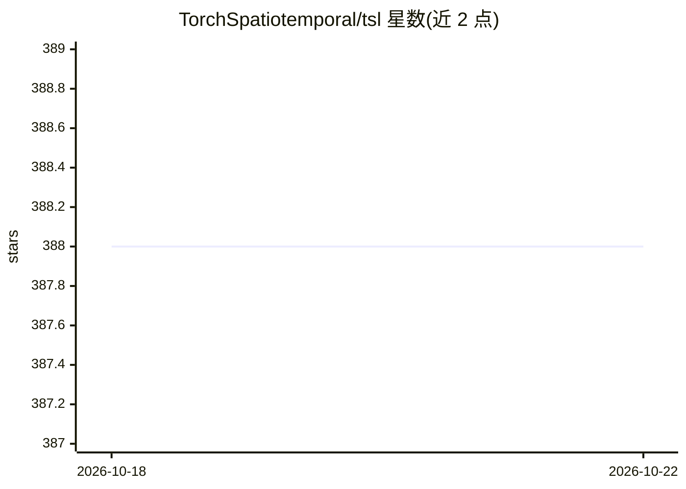

# TorchSpatiotemporal/tsl

⭐ 388 · Python · MIT · 推送 2026-09-25 · [GitHub](https://github.com/TorchSpatiotemporal/tsl) · [官网](https://torch-spatiotemporal.readthedocs.io/) · 组织维护

**面向研究的 PyTorch 时空（图神经网络）预测库**

Torch Spatiotemporal（tsl）是基于 PyTorch、PyG 与 PyTorch Lightning 构建的 Python 库，用于加速神经时空数据处理方法研究，重点是图神经网络。功能覆盖自定义模型与数据集构建、公开数据集与基准模型访问、缺失数据与不规则网络结构处理、时间序列缩放/重采样/聚类的预处理、专用神经层模块，以及通过 Hydra 框架保证实验可复现。面向从事时空预测（如传感器网络、交通、环境数据）的研究者与开发者，以 pip/uv/conda 安装的 Python 库形式提供。

## 筛选速览

| 维度 | 判定 | 备注 |
|---|---|---|
| AI 角色 | `ai-native` | 本体是模型或模型工具 |
| 许可风险 | `permissive` | MIT |
| 部署形态 | `library` | 以包/库形式分发 |
| 模型依赖 | — | README 未给出锁定关系 |
| 硬件要求 | — | 无带数字的原话,不猜 |
| 安装摩擦 | `medium` | 含编译或系统依赖之一 |
| 成熟度 | — | 结构信号不足 |

## 能力要点

- 统一框架覆盖从预处理到模型原型设计的时空数据流程
- 内置文献中的公开数据集与基准模型用于对比实验
- 处理缺失数据与网络结构变化的时空数据流
- 与 PyTorch Lightning 集成支持从单 CPU 到 GPU 集群扩展，Hydra 保证可复现

## 适用场景

- 在公开时空数据集上原型化并评测图神经网络模型
- 处理传感器网络、交通或环境数据中的缺失与不规则性
- 做可复现的时空预测/填补实验并与文献基线对比

## 场景标签

`科研工具` · 领域:学习与行业

## 证据(README 行号)

> L16:  tsl (Torch Spatiotemporal) is a library built to accelerate research on neural spatiotemporal data processing
> L19:  Built upon popular libraries such as PyTorch , PyG (PyTorch Geometric), and PyTorch Lightning, tsl provides a unif

## 星数曲线

2026-10-18 388 → 2026-10-22 388（+0）

---
*卡片 v1 · prompt 1.4 · 生成 2026-10-21 · 置信度 high · 依据 README sha `fe09a04aaf84` · [字段定义](../../DATASET.md)*
