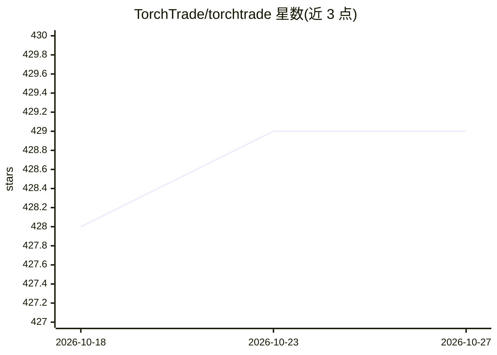

# TorchTrade/torchtrade

⭐ 429 · Python · MIT · 推送 2026-10-08 · [GitHub](https://github.com/TorchTrade/torchtrade) · [官网](https://torchtrade.github.io/torchtrade.io/) · 组织维护

**面向算法交易的模块化强化学习框架，基于 TorchRL 构建**

基于 TorchRL 的机器学习交易框架，支持在线/离线 RL、model-based RL、对比学习等方法，内置 PPO、DQN、IQL、GRPO 等算法实现。提供离线回测环境与 Alpaca、Binance、Bitget、Bybit、OKX 等交易所的实盘环境（Polymarket 仅纸面交易），支持多时间框架观测与多资产组合配置。LLM 可作为交易 actor（GPT-4o-mini 或本地模型），可工具调用并以 GRPO/SAO 微调。README 声明项目处于开发中，API 可能变化。安装使用 UV，需 Python 3.11+。

## 筛选速览

| 维度 | 判定 | 备注 |
|---|---|---|
| AI 角色 | `ai-ecosystem` | LLM/agent 周边工具 |
| 许可风险 | `permissive` | MIT |
| 部署形态 | `None` |  |
| 模型依赖 | — | README 未给出锁定关系 |
| 硬件要求 | — | 无带数字的原话,不猜 |
| 安装摩擦 | `low` | 无编译、无系统依赖或容器化 |
| 成熟度 | `idea` | |

## 能力要点

- 内置 PPO/DQN/IQL/GRPO/DSAC/CTRL 等多种 RL 算法实现
- 离线回测与实盘交易共用同一代码（Alpaca/Binance/Bitget/Bybit/OKX 集成）
- LLM 作为交易 actor，支持工具调用与 GRPO/SAO 微调本地 LLM
- 多时间框架观测（1m/5m/15m/1h 同时训练）与多资产组合环境

## 适用场景

- 在历史 OHLCV 数据上回测训练 RL 交易策略
- 部署 RL 或 LLM actor 到加密货币交易所进行实盘交易
- 做多资产组合配置研究，与 UBAH/UCRP/OLMAR 基线对比

## 场景标签

`金融量化` `强化学习` · 领域:学习与行业

## 证据(README 行号)

> L21: **A machine learning framework for algorithmic trading built on TorchRL.**
> L23: TorchTrade's goal is to provide accessible deployment of RL methods to trading. The framework supports various RL m

## 星数曲线

2026-10-18 428 → 2026-10-27 429（+1）

---
*卡片 v1 · prompt 1.4 · 生成 2026-10-23 · 置信度 high · 依据 README sha `084f1827c4f6` · [字段定义](../../DATASET.md)*
